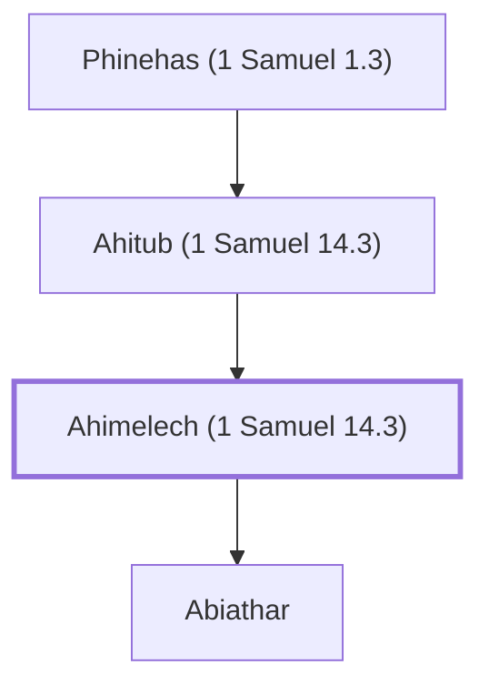

# Ahimelech (1 Samuel 14.3)

High Priest at Nob who helped David, killed by Saul

**Also called:** Ahijah

**Original-language names:** אֲחִימֶ֫לֶךְ (H0288) · אֲחִיָּ֫הוּ (H0281)

## When

- **Placed around:** [[connections/timeline/11th century BC|1062 BC]] *(Ussher: the median date of the passages naming them)*

## Family

- **Father:** [[connections/people/Ahitub (1 Samuel 14.3)|Ahitub (1 Samuel 14.3)]]
- **Children:** [[connections/people/Abiathar|Abiathar]]
- **Tribe or nation:** Tribe of Levi

**Line of descent** (4 generations, father to son): [[connections/people/Eli|Eli]] → [[connections/people/Phinehas (1 Samuel 1.3)|Phinehas (1 Samuel 1.3)]] → [[connections/people/Ahitub (1 Samuel 14.3)|Ahitub (1 Samuel 14.3)]] → **Ahimelech (1 Samuel 14.3)**

**Family group:** [[connections/genealogy/Family of Adam|Family of Adam]], generation 36

## Appears in

[[connections/chapters/09-1-samuel/1 Samuel 14|1 Samuel 14 (2)]] · [[connections/chapters/09-1-samuel/1 Samuel 21|1 Samuel 21 (3)]] · [[connections/chapters/09-1-samuel/1 Samuel 22|1 Samuel 22 (5)]] · [[connections/chapters/09-1-samuel/1 Samuel 23|1 Samuel 23]] · [[connections/chapters/09-1-samuel/1 Samuel 30|1 Samuel 30]] · [[connections/chapters/19-psalms/Psalms 52|Psalms 52]]

## Appears in the same verse as

[[connections/people/David|David (8)]] · [[connections/people/Ahitub (1 Samuel 14.3)|Ahitub (1 Samuel 14.3) (4)]] · [[connections/people/Abiathar|Abiathar (3)]] · [[connections/people/Saul|Saul (3)]] · [[connections/places/Nob|Nob (3)]] · [[connections/people/Doeg|Doeg (2)]] · [[connections/people/Eli|Eli]] · [[connections/people/Ichabod|Ichabod]] · [[connections/people/Israel|Israel]] · [[connections/people/Jesse|Jesse]] · [[connections/people/Jonathan (1 Samuel 13.2)|Jonathan (1 Samuel 13.2)]] · [[connections/people/Phinehas (1 Samuel 1.3)|Phinehas (1 Samuel 1.3)]] · [[connections/places/Keilah|Keilah]] · [[connections/places/Shiloh|Shiloh]]
