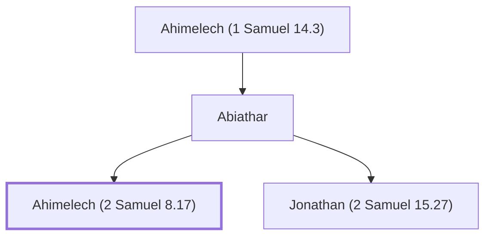

# Ahimelech (2 Samuel 8.17)

Son of Abiathar, a priest during David's reign

**Original-language names:** אֲחִימֶ֫לֶךְ (H0288) · אֲבִימֶ֫לֶךְ (H0040)

## When

- **Placed around:** [[connections/timeline/11th century BC|1015 BC]] *(Ussher: the median date of the passages naming them)*

## Family

- **Father:** [[connections/people/Abiathar|Abiathar]]
- **Brothers and sisters:** [[connections/people/Jonathan (2 Samuel 15.27)|Jonathan (2 Samuel 15.27)]]
- **Tribe or nation:** Tribe of Levi

**Line of descent** (6 generations, father to son): [[connections/people/Eli|Eli]] → [[connections/people/Phinehas (1 Samuel 1.3)|Phinehas (1 Samuel 1.3)]] → [[connections/people/Ahitub (1 Samuel 14.3)|Ahitub (1 Samuel 14.3)]] → [[connections/people/Ahimelech (1 Samuel 14.3)|Ahimelech (1 Samuel 14.3)]] → [[connections/people/Abiathar|Abiathar]] → **Ahimelech (2 Samuel 8.17)**

**Family group:** [[connections/genealogy/Family of Adam|Family of Adam]], generation 38

## Appears in

[[connections/chapters/10-2-samuel/2 Samuel 8|2 Samuel 8]] · [[connections/chapters/13-1-chronicles/1 Chronicles 18|1 Chronicles 18]] · [[connections/chapters/13-1-chronicles/1 Chronicles 24|1 Chronicles 24 (3)]]

## Appears in the same verse as

[[connections/people/Zadok (2 Samuel 8.17)|Zadok (2 Samuel 8.17) (5)]] · [[connections/people/Abiathar|Abiathar (3)]] · [[connections/people/Ahitub (2 Samuel 8.17)|Ahitub (2 Samuel 8.17) (2)]] · [[connections/people/David|David (2)]] · [[connections/people/Eleazar (Exodus 6.23)|Eleazar (Exodus 6.23) (2)]] · [[connections/people/Ithamar|Ithamar (2)]] · [[connections/people/Seraiah (2 Samuel 8.17)|Seraiah (2 Samuel 8.17) (2)]] · [[connections/people/Aaron|Aaron]] · [[connections/people/Nethanel (1 Chronicles 24.6)|Nethanel (1 Chronicles 24.6)]] · [[connections/people/Shemaiah (1 Chronicles 24.6)|Shemaiah (1 Chronicles 24.6)]]
