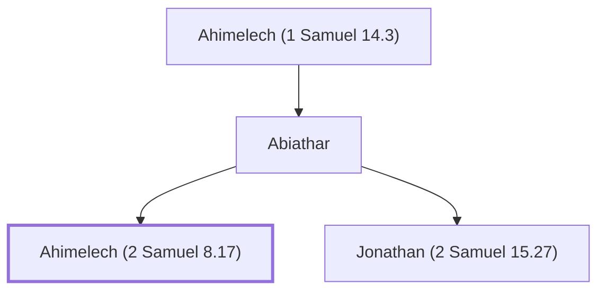

# Ahimelech (2 Samuel 8.17)

Son of Abiathar, a priest during David's reign

**Original-language names:** אֲחִימֶ֫לֶךְ (H0288) · אֲבִימֶ֫לֶךְ (H0040)

## When

- **Placed around:** [[connections/timeline/11th century BC|1015 BC]] *(Ussher: the median date of the passages naming them)*

## Family

- **Father:** [[connections/people/Abiathar|Abiathar]]
- **Brothers and sisters:** [[connections/people/Jonathan (2 Samuel 15.27)|Jonathan (2 Samuel 15.27)]]
- **Tribe or nation:** Tribe of Levi

**Line of descent** (38 generations, father to son): [[connections/people/Adam|Adam]] → [[connections/people/Seth|Seth]] → [[connections/people/Enosh|Enosh]] → [[connections/people/Kenan|Kenan]] → [[connections/people/Mahalalel (Genesis 5.12)|Mahalalel (Genesis 5.12)]] → [[connections/people/Jared|Jared]] → [[connections/people/Enoch (Genesis 5.18)|Enoch (Genesis 5.18)]] → [[connections/people/Methuselah|Methuselah]] → [[connections/people/Lamech (Genesis 5.25)|Lamech (Genesis 5.25)]] → [[connections/people/Noah (Genesis 5.29)|Noah (Genesis 5.29)]] → [[connections/people/Shem|Shem]] → [[connections/people/Arpachshad|Arpachshad]] → [[connections/people/Cainan|Cainan]] → [[connections/people/Shelah (Genesis 10.24)|Shelah (Genesis 10.24)]] → [[connections/people/Eber (Genesis 10.21)|Eber (Genesis 10.21)]] → [[connections/people/Peleg|Peleg]] → [[connections/people/Reu|Reu]] → [[connections/people/Serug|Serug]] → [[connections/people/Nahor (Genesis 11.22)|Nahor (Genesis 11.22)]] → [[connections/people/Terah|Terah]] → [[connections/people/Abraham|Abraham]] → [[connections/people/Isaac|Isaac]] → [[connections/people/Israel|Israel]] → [[connections/people/Levi (Genesis 29.34)|Levi (Genesis 29.34)]] → [[connections/people/Kohath|Kohath]] → [[connections/people/Amram (Exodus 6.18)|Amram (Exodus 6.18)]] → [[connections/people/Aaron|Aaron]] → [[connections/people/Ithamar|Ithamar]] → [[connections/people/Unnamed 1 (1 Kings 2.27)|Unnamed 1 (1 Kings 2.27)]] → [[connections/people/Unnamed 2 (1 Kings 2.27)|Unnamed 2 (1 Kings 2.27)]] → [[connections/people/Unnamed 3 (1 Kings 2.27)|Unnamed 3 (1 Kings 2.27)]] → [[connections/people/Unnamed 4 (1 Kings 2.27)|Unnamed 4 (1 Kings 2.27)]] → [[connections/people/Eli|Eli]] → [[connections/people/Phinehas (1 Samuel 1.3)|Phinehas (1 Samuel 1.3)]] → [[connections/people/Ahitub (1 Samuel 14.3)|Ahitub (1 Samuel 14.3)]] → [[connections/people/Ahimelech (1 Samuel 14.3)|Ahimelech (1 Samuel 14.3)]] → [[connections/people/Abiathar|Abiathar]] → **Ahimelech (2 Samuel 8.17)**

**Family group:** [[connections/genealogy/Family of Adam|Family of Adam]], generation 38

## Appears in

[[connections/chapters/10-2-samuel/2 Samuel 8|2 Samuel 8]] · [[connections/chapters/13-1-chronicles/1 Chronicles 18|1 Chronicles 18]] · [[connections/chapters/13-1-chronicles/1 Chronicles 24|1 Chronicles 24 (3)]]

## Appears in the same verse as

[[connections/people/Zadok (2 Samuel 8.17)|Zadok (2 Samuel 8.17) (5)]] · [[connections/people/Abiathar|Abiathar (3)]] · [[connections/people/Ahitub (2 Samuel 8.17)|Ahitub (2 Samuel 8.17) (2)]] · [[connections/people/David|David (2)]] · [[connections/people/Eleazar (Exodus 6.23)|Eleazar (Exodus 6.23) (2)]] · [[connections/people/Ithamar|Ithamar (2)]] · [[connections/people/Seraiah (2 Samuel 8.17)|Seraiah (2 Samuel 8.17) (2)]] · [[connections/people/Aaron|Aaron]] · [[connections/people/Nethanel (1 Chronicles 24.6)|Nethanel (1 Chronicles 24.6)]] · [[connections/people/Shemaiah (1 Chronicles 24.6)|Shemaiah (1 Chronicles 24.6)]]
