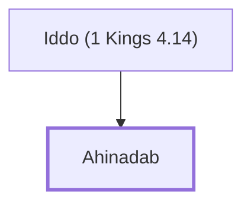

# Ahinadab

Son of Iddo, a governor under Solomon

**Original-language names:** אֲחִינָדָב (H0292)

## When

- **Placed around:** [[connections/timeline/11th century BC|1014 BC]] *(Ussher: the median date of the passages naming them)*

## Family

- **Father:** [[connections/people/Iddo (1 Kings 4.14)|Iddo (1 Kings 4.14)]]

**Family group:** [[connections/genealogy/Family of Iddo (1 Kings 4.14)|Family of Iddo (1 Kings 4.14)]], generation 2

## Appears in

[[connections/chapters/11-1-kings/1 Kings 4|1 Kings 4]]

## Appears in the same verse as

[[connections/people/Iddo (1 Kings 4.14)|Iddo (1 Kings 4.14)]] · [[connections/places/Mahanaim|Mahanaim]]
