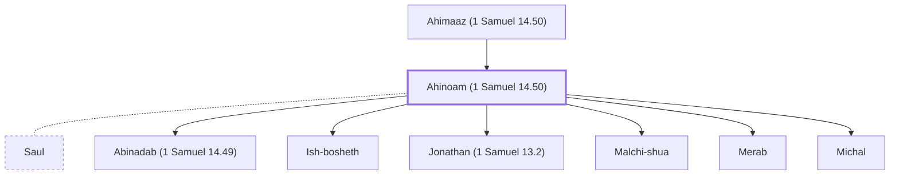

# Ahinoam (1 Samuel 14.50)

Wife of King Saul, daughter of Ahimaaz

**Original-language names:** אֲחִינֹ֫עַם (H0293)

## When

- **Placed around:** [[connections/timeline/11th century BC|1087 BC]] *(Ussher: the median date of the passages naming them)*

## Family

- **Father:** [[connections/people/Ahimaaz (1 Samuel 14.50)|Ahimaaz (1 Samuel 14.50)]]
- **Spouses:** [[connections/people/Saul|Saul]]
- **Children:** [[connections/people/Abinadab (1 Samuel 14.49)|Abinadab (1 Samuel 14.49)]], [[connections/people/Ish-bosheth|Ish-bosheth (uncertain)]], [[connections/people/Jonathan (1 Samuel 13.2)|Jonathan (1 Samuel 13.2)]], [[connections/people/Malchi-shua|Malchi-shua]], [[connections/people/Merab|Merab]], [[connections/people/Michal|Michal]]

**Family group:** [[connections/genealogy/Family of Aphiah|Family of Aphiah]], generation 2

## Appears in

[[connections/chapters/09-1-samuel/1 Samuel 14|1 Samuel 14]]

## Appears in the same verse as

[[connections/people/Abner|Abner]] · [[connections/people/Ahimaaz (1 Samuel 14.50)|Ahimaaz (1 Samuel 14.50)]] · [[connections/people/Ner|Ner]] · [[connections/people/Saul|Saul]]
