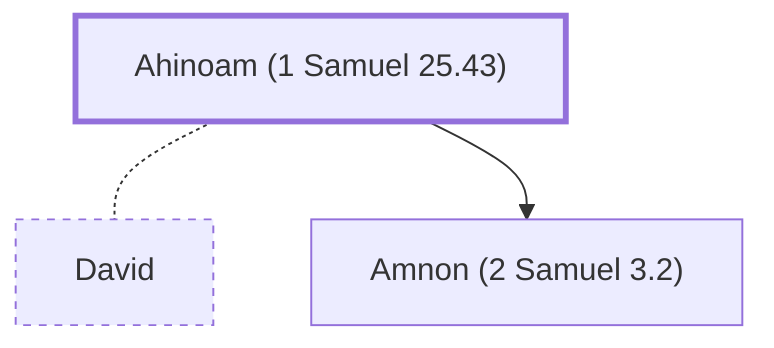

# Ahinoam (1 Samuel 25.43)

Wife of David, from Jezreel; mother of Amnon

**Original-language names:** אֲחִינֹ֫עַם (H0293)

## When

- **Placed around:** [[connections/timeline/11th century BC|1056 BC]] *(Ussher: the median date of the passages naming them)*

## Family

- **Spouses:** [[connections/people/David|David]]
- **Children:** [[connections/people/Amnon (2 Samuel 3.2)|Amnon (2 Samuel 3.2)]]

**Family group:** [[connections/genealogy/Family of Adam|Family of Adam]], generation 36

## Appears in

[[connections/chapters/09-1-samuel/1 Samuel 25|1 Samuel 25]] · [[connections/chapters/09-1-samuel/1 Samuel 27|1 Samuel 27]] · [[connections/chapters/09-1-samuel/1 Samuel 30|1 Samuel 30]] · [[connections/chapters/10-2-samuel/2 Samuel 2|2 Samuel 2]] · [[connections/chapters/10-2-samuel/2 Samuel 3|2 Samuel 3]] · [[connections/chapters/13-1-chronicles/1 Chronicles 3|1 Chronicles 3]]

## Appears in the same verse as

[[connections/people/David|David (6)]] · [[connections/places/Jezreel (Joshua 15.56)|Jezreel (Joshua 15.56) (5)]] · [[connections/people/Abigail (1 Samuel 25.3)|Abigail (1 Samuel 25.3) (4)]] · [[connections/people/Nabal|Nabal (3)]] · [[connections/people/Amnon (2 Samuel 3.2)|Amnon (2 Samuel 3.2) (2)]] · [[connections/places/Hebron|Hebron (2)]] · [[connections/people/Achish|Achish]] · [[connections/people/Chileab|Chileab]] · [[connections/places/Gath|Gath]]
