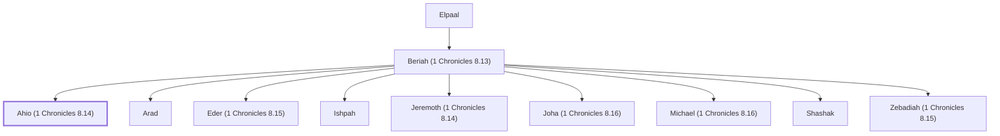

# Ahio (1 Chronicles 8.14)

Son of Beriah, a Benjamite

**Original-language names:** אַחְיוֹ (H0283)

## Family

- **Father:** [[connections/people/Beriah (1 Chronicles 8.13)|Beriah (1 Chronicles 8.13)]]
- **Brothers and sisters:** [[connections/people/Arad|Arad]], [[connections/people/Eder (1 Chronicles 8.15)|Eder (1 Chronicles 8.15)]], [[connections/people/Ishpah|Ishpah]], [[connections/people/Jeremoth (1 Chronicles 8.14)|Jeremoth (1 Chronicles 8.14)]], [[connections/people/Joha (1 Chronicles 8.16)|Joha (1 Chronicles 8.16)]], [[connections/people/Michael (1 Chronicles 8.16)|Michael (1 Chronicles 8.16)]], [[connections/people/Shashak|Shashak]], [[connections/people/Zebadiah (1 Chronicles 8.15)|Zebadiah (1 Chronicles 8.15)]]
- **Tribe or nation:** Tribe of Benjamin

**Line of descent** (4 generations, father to son): [[connections/people/Shaharaim|Shaharaim]] → [[connections/people/Elpaal|Elpaal]] → [[connections/people/Beriah (1 Chronicles 8.13)|Beriah (1 Chronicles 8.13)]] → **Ahio (1 Chronicles 8.14)**

**Family group:** [[connections/genealogy/Family of Shaharaim|Family of Shaharaim]], generation 4

## Appears in

[[connections/chapters/13-1-chronicles/1 Chronicles 8|1 Chronicles 8]]

## Appears in the same verse as

[[connections/people/Jeremoth (1 Chronicles 8.14)|Jeremoth (1 Chronicles 8.14)]] · [[connections/people/Shashak|Shashak]]
