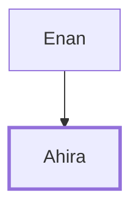

# Ahira

Leader of the tribe of Naphtali during the Exodus

**Original-language names:** אֲחִירַע (H0299)

## When

- **Placed around:** [[connections/timeline/15th century BC|1490 BC]] *(Ussher: the median date of the passages naming them)*

## Family

- **Father:** [[connections/people/Enan|Enan]]
- **Tribe or nation:** Tribe of Naphtali

**Family group:** [[connections/genealogy/Family of Enan|Family of Enan]], generation 2

## Appears in

[[connections/chapters/04-numbers/Numbers 1|Numbers 1]] · [[connections/chapters/04-numbers/Numbers 2|Numbers 2]] · [[connections/chapters/04-numbers/Numbers 7|Numbers 7 (2)]] · [[connections/chapters/04-numbers/Numbers 10|Numbers 10]]

## Appears in the same verse as

[[connections/people/Enan|Enan (5)]] · [[connections/people/Naphtali|Naphtali (4)]]
