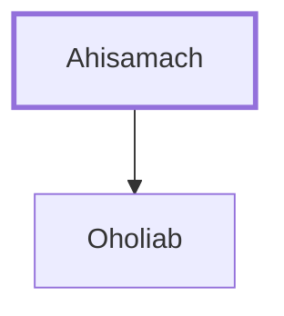

# Ahisamach

Father of Oholiab, a skilled artisan for the tabernacle

**Original-language names:** אֲחִיסָמָךְ (H0294)

## When

- **Placed around:** [[connections/timeline/15th century BC|1491 BC]] *(Ussher: the median date of the passages naming them)*

## Family

- **Children:** [[connections/people/Oholiab|Oholiab]]

**Family group:** [[connections/genealogy/Family of Ahisamach|Family of Ahisamach]], generation 1

## Appears in

[[connections/chapters/02-exodus/Exodus 31|Exodus 31]] · [[connections/chapters/02-exodus/Exodus 35|Exodus 35]] · [[connections/chapters/02-exodus/Exodus 38|Exodus 38]]

## Appears in the same verse as

[[connections/people/Oholiab|Oholiab (3)]] · [[connections/places/Dan|Dan (3)]]
