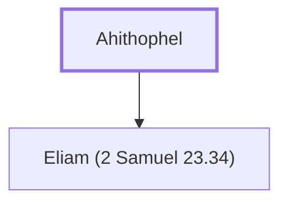

# Ahithophel

David's counselor who joined Absalom's rebellion, later committed suicide

**Original-language names:** אֲחִיתֹ֫פֶל (H0302)

## When

- **Placed around:** [[connections/timeline/11th century BC|1023 BC]] *(Ussher: the median date of the passages naming them)*

## Family

- **Children:** [[connections/people/Eliam (2 Samuel 23.34)|Eliam (2 Samuel 23.34)]]

**Family group:** [[connections/genealogy/Family of Ahithophel|Family of Ahithophel]], generation 1

## Appears in

[[connections/chapters/10-2-samuel/2 Samuel 15|2 Samuel 15 (3)]] · [[connections/chapters/10-2-samuel/2 Samuel 16|2 Samuel 16 (4)]] · [[connections/chapters/10-2-samuel/2 Samuel 17|2 Samuel 17 (7)]] · [[connections/chapters/10-2-samuel/2 Samuel 23|2 Samuel 23]] · [[connections/chapters/13-1-chronicles/1 Chronicles 27|1 Chronicles 27 (2)]]

## Appears in the same verse as

[[connections/people/Absalom|Absalom (12)]] · [[connections/people/David|David (5)]] · [[connections/people/Hushai|Hushai (5)]] · [[connections/people/Israel|Israel (4)]] · [[connections/people/Abiathar|Abiathar (2)]] · [[connections/people/Ahasbai|Ahasbai]] · [[connections/people/Benaiah (1 Chronicles 27.34)|Benaiah (1 Chronicles 27.34)]] · [[connections/people/Eliam (2 Samuel 23.34)|Eliam (2 Samuel 23.34)]] · [[connections/people/Eliphelet (2 Samuel 23.34)|Eliphelet (2 Samuel 23.34)]] · [[connections/people/Jehoiada (1 Chronicles 27.34)|Jehoiada (1 Chronicles 27.34)]] · [[connections/people/Joab (1 Samuel 26.6)|Joab (1 Samuel 26.6)]] · [[connections/people/Zadok (2 Samuel 8.17)|Zadok (2 Samuel 8.17)]] · [[connections/places/Giloh|Giloh]] · [[connections/places/Jerusalem|Jerusalem]]
