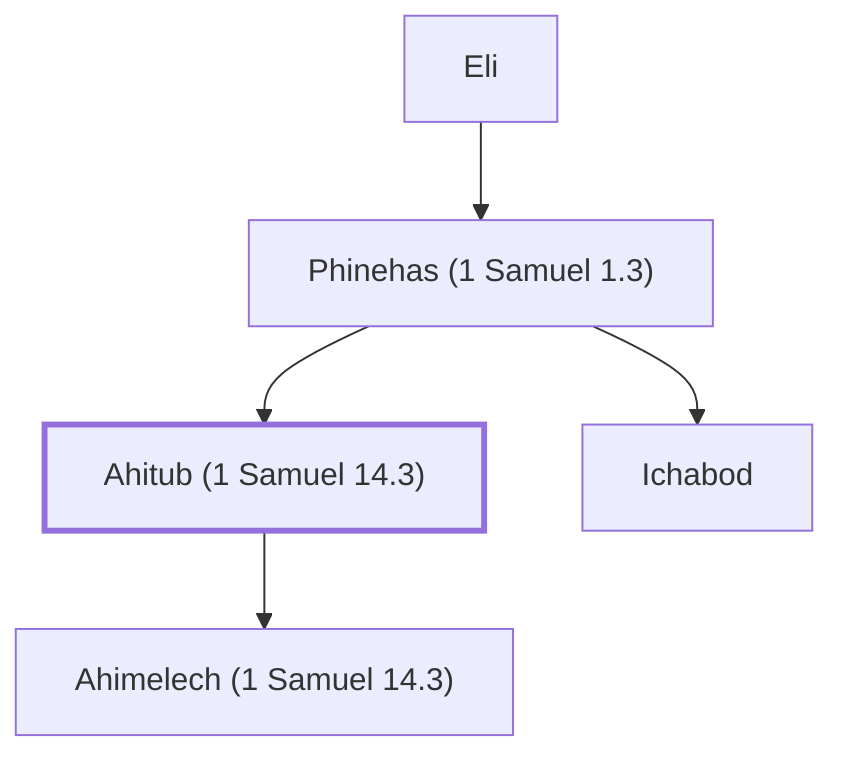

# Ahitub (1 Samuel 14.3)

Father of Ahimelech, High Priest at Nob killed by Saul

**Original-language names:** אֲחִיטוּב (H0285)

## When

- **Placed around:** [[connections/timeline/11th century BC|1062 BC]] *(Ussher: the median date of the passages naming them)*

## Family

- **Father:** [[connections/people/Phinehas (1 Samuel 1.3)|Phinehas (1 Samuel 1.3)]]
- **Brothers and sisters:** [[connections/people/Ichabod|Ichabod]]
- **Children:** [[connections/people/Ahimelech (1 Samuel 14.3)|Ahimelech (1 Samuel 14.3)]]
- **Tribe or nation:** Tribe of Levi

**Line of descent** (3 generations, father to son): [[connections/people/Eli|Eli]] → [[connections/people/Phinehas (1 Samuel 1.3)|Phinehas (1 Samuel 1.3)]] → **Ahitub (1 Samuel 14.3)**

**Family group:** [[connections/genealogy/Family of Adam|Family of Adam]], generation 35

## Appears in

[[connections/chapters/09-1-samuel/1 Samuel 14|1 Samuel 14]] · [[connections/chapters/09-1-samuel/1 Samuel 22|1 Samuel 22 (4)]]

## Appears in the same verse as

[[connections/people/Ahimelech (1 Samuel 14.3)|Ahimelech (1 Samuel 14.3) (4)]] · [[connections/people/Saul|Saul (2)]] · [[connections/places/Nob|Nob (2)]] · [[connections/people/Abiathar|Abiathar]] · [[connections/people/David|David]] · [[connections/people/Doeg|Doeg]] · [[connections/people/Eli|Eli]] · [[connections/people/Ichabod|Ichabod]] · [[connections/people/Jesse|Jesse]] · [[connections/people/Jonathan (1 Samuel 13.2)|Jonathan (1 Samuel 13.2)]] · [[connections/people/Phinehas (1 Samuel 1.3)|Phinehas (1 Samuel 1.3)]] · [[connections/places/Shiloh|Shiloh]]
