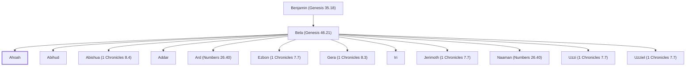

# Ahoah

Descendant of Benjamin, clan of David's mighty men

**Original-language names:** אֲחוֹחַ (H0265)

## Family

- **Father:** [[connections/people/Bela (Genesis 46.21)|Bela (Genesis 46.21)]]
- **Brothers and sisters:** [[connections/people/Abihud|Abihud]], [[connections/people/Abishua (1 Chronicles 8.4)|Abishua (1 Chronicles 8.4)]], [[connections/people/Addar|Addar]], [[connections/people/Ard (Numbers 26.40)|Ard (Numbers 26.40)]], [[connections/people/Ezbon (1 Chronicles 7.7)|Ezbon (1 Chronicles 7.7)]], [[connections/people/Gera (1 Chronicles 8.3)|Gera (1 Chronicles 8.3)]], [[connections/people/Iri|Iri]], [[connections/people/Jerimoth (1 Chronicles 7.7)|Jerimoth (1 Chronicles 7.7)]], [[connections/people/Naaman (Numbers 26.40)|Naaman (Numbers 26.40)]], [[connections/people/Uzzi (1 Chronicles 7.7)|Uzzi (1 Chronicles 7.7)]], [[connections/people/Uzziel (1 Chronicles 7.7)|Uzziel (1 Chronicles 7.7)]]
- **Tribe or nation:** Tribe of Benjamin

**Line of descent** (26 generations, father to son): [[connections/people/Adam|Adam]] → [[connections/people/Seth|Seth]] → [[connections/people/Enosh|Enosh]] → [[connections/people/Kenan|Kenan]] → [[connections/people/Mahalalel (Genesis 5.12)|Mahalalel (Genesis 5.12)]] → [[connections/people/Jared|Jared]] → [[connections/people/Enoch (Genesis 5.18)|Enoch (Genesis 5.18)]] → [[connections/people/Methuselah|Methuselah]] → [[connections/people/Lamech (Genesis 5.25)|Lamech (Genesis 5.25)]] → [[connections/people/Noah (Genesis 5.29)|Noah (Genesis 5.29)]] → [[connections/people/Shem|Shem]] → [[connections/people/Arpachshad|Arpachshad]] → [[connections/people/Cainan|Cainan]] → [[connections/people/Shelah (Genesis 10.24)|Shelah (Genesis 10.24)]] → [[connections/people/Eber (Genesis 10.21)|Eber (Genesis 10.21)]] → [[connections/people/Peleg|Peleg]] → [[connections/people/Reu|Reu]] → [[connections/people/Serug|Serug]] → [[connections/people/Nahor (Genesis 11.22)|Nahor (Genesis 11.22)]] → [[connections/people/Terah|Terah]] → [[connections/people/Abraham|Abraham]] → [[connections/people/Isaac|Isaac]] → [[connections/people/Israel|Israel]] → [[connections/people/Benjamin (Genesis 35.18)|Benjamin (Genesis 35.18)]] → [[connections/people/Bela (Genesis 46.21)|Bela (Genesis 46.21)]] → **Ahoah**

**Family group:** [[connections/genealogy/Family of Adam|Family of Adam]], generation 26

## Appears in

[[connections/chapters/13-1-chronicles/1 Chronicles 8|1 Chronicles 8]]

## Appears in the same verse as

[[connections/people/Abishua (1 Chronicles 8.4)|Abishua (1 Chronicles 8.4)]] · [[connections/people/Naaman (Numbers 26.40)|Naaman (Numbers 26.40)]]
