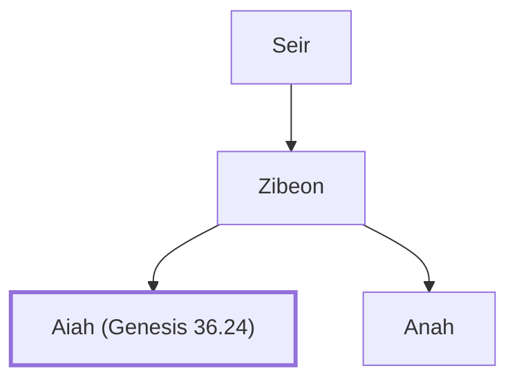

# Aiah (Genesis 36.24)

Son of Zibeon the Hivite, brother of Anah

**Original-language names:** אַיָּה (H0345)

## When

- **Placed around:** [[connections/timeline/18th century BC|1756 BC]] *(Ussher: the median date of the passages naming them)*

## Family

- **Father:** [[connections/people/Zibeon|Zibeon]]
- **Brothers and sisters:** [[connections/people/Anah|Anah]]
- **Tribe or nation:** Edom

**Line of descent** (3 generations, father to son): [[connections/people/Seir|Seir]] → [[connections/people/Zibeon|Zibeon]] → **Aiah (Genesis 36.24)**

**Family group:** [[connections/genealogy/Family of Adam|Family of Adam]], generation 3

## Appears in

[[connections/chapters/01-genesis/Genesis 36|Genesis 36]] · [[connections/chapters/13-1-chronicles/1 Chronicles 1|1 Chronicles 1]]

## Appears in the same verse as

[[connections/people/Anah|Anah (2)]] · [[connections/people/Alvan|Alvan]] · [[connections/people/Ebal|Ebal]] · [[connections/people/Manahath|Manahath]] · [[connections/people/Onam (Genesis 36.23)|Onam (Genesis 36.23)]] · [[connections/people/Shepho|Shepho]] · [[connections/people/Shobal (Genesis 36.20)|Shobal (Genesis 36.20)]]
