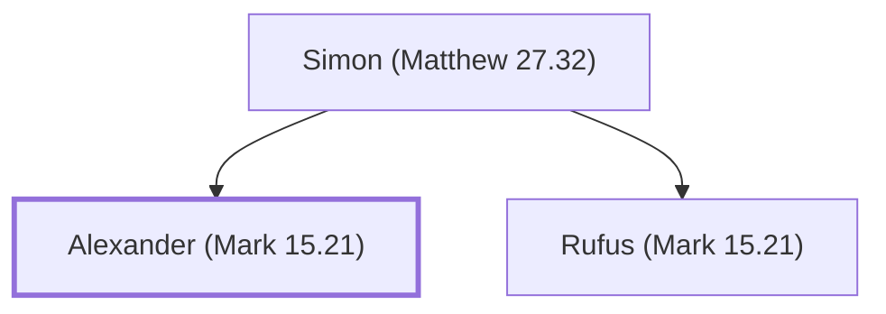

# Alexander (Mark 15.21)

Son of Simon who carried the cross

**Original-language names:** Ἀλέξανδρος (G0223)

## When

- **Placed around:** [[connections/timeline/1st century AD|AD 33]] *(Ussher: the median date of the passages naming them)*

## Family

- **Father:** [[connections/people/Simon (Matthew 27.32)|Simon (Matthew 27.32)]]
- **Brothers and sisters:** [[connections/people/Rufus (Mark 15.21)|Rufus (Mark 15.21)]]

**Family group:** [[connections/genealogy/Family of Simon (Matthew 27.32)|Family of Simon (Matthew 27.32)]], generation 2

## Appears in

[[connections/chapters/41-mark/Mark 15|Mark 15]]

## Appears in the same verse as

[[connections/people/Rufus (Mark 15.21)|Rufus (Mark 15.21)]] · [[connections/people/Simon (Matthew 27.32)|Simon (Matthew 27.32)]] · [[connections/places/Cyrene|Cyrene]]
