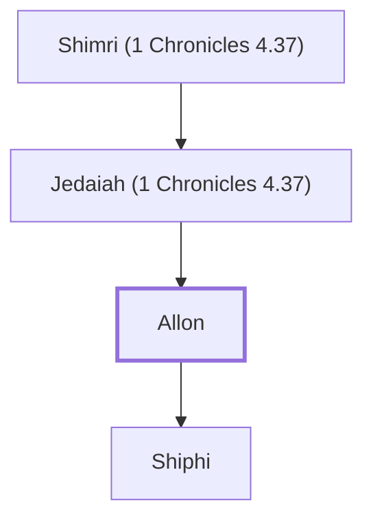

# Allon

Son of Jedaiah, a Simeonite

**Original-language names:** אַלּוֹן (H0438)

## When

- **Placed around:** [[connections/timeline/18th century BC|1721 BC]] *(Ussher: the median date of the passages naming them)*

## Family

- **Father:** [[connections/people/Jedaiah (1 Chronicles 4.37)|Jedaiah (1 Chronicles 4.37)]]
- **Children:** [[connections/people/Shiphi|Shiphi]]
- **Tribe or nation:** Tribe of Simeon

**Line of descent** (4 generations, father to son): [[connections/people/Shemaiah (1 Chronicles 4.37)|Shemaiah (1 Chronicles 4.37)]] → [[connections/people/Shimri (1 Chronicles 4.37)|Shimri (1 Chronicles 4.37)]] → [[connections/people/Jedaiah (1 Chronicles 4.37)|Jedaiah (1 Chronicles 4.37)]] → **Allon**

**Family group:** [[connections/genealogy/Family of Shemaiah (1 Chronicles 4.37)|Family of Shemaiah (1 Chronicles 4.37)]], generation 4

## Appears in

[[connections/chapters/13-1-chronicles/1 Chronicles 4|1 Chronicles 4]]

## Appears in the same verse as

[[connections/people/Jedaiah (1 Chronicles 4.37)|Jedaiah (1 Chronicles 4.37)]] · [[connections/people/Shemaiah (1 Chronicles 4.37)|Shemaiah (1 Chronicles 4.37)]] · [[connections/people/Shimri (1 Chronicles 4.37)|Shimri (1 Chronicles 4.37)]] · [[connections/people/Shiphi|Shiphi]] · [[connections/people/Ziza (1 Chronicles 4.37)|Ziza (1 Chronicles 4.37)]]
