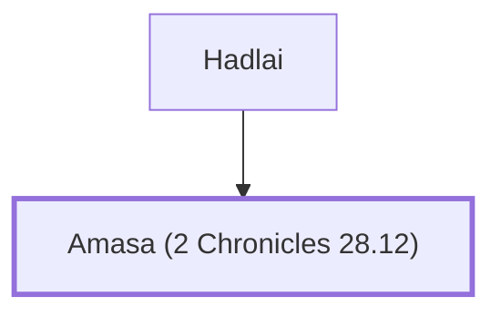

# Amasa (2 Chronicles 28.12)

Ephraimite leader who opposed enslaving Judahite captives

**Original-language names:** עֲמָשָׂא (H6021)

## When

- **Placed around:** [[connections/timeline/8th century BC|742 BC]] *(Ussher: the median date of the passages naming them)*

## Family

- **Father:** [[connections/people/Hadlai|Hadlai]]

**Family group:** [[connections/genealogy/Family of Hadlai|Family of Hadlai]], generation 2

## Appears in

[[connections/chapters/14-2-chronicles/2 Chronicles 28|2 Chronicles 28]]

## Appears in the same verse as

[[connections/people/Azariah (2 Chronicles 28.12)|Azariah (2 Chronicles 28.12)]] · [[connections/people/Berechiah (2 Chronicles 28.12)|Berechiah (2 Chronicles 28.12)]] · [[connections/people/Ephraim|Ephraim]] · [[connections/people/Hadlai|Hadlai]] · [[connections/people/Jehizkiah|Jehizkiah]] · [[connections/people/Johanan (2 Chronicles 28.12)|Johanan (2 Chronicles 28.12)]] · [[connections/people/Meshillemoth|Meshillemoth]] · [[connections/people/Shallum (2 Chronicles 28.12)|Shallum (2 Chronicles 28.12)]]
