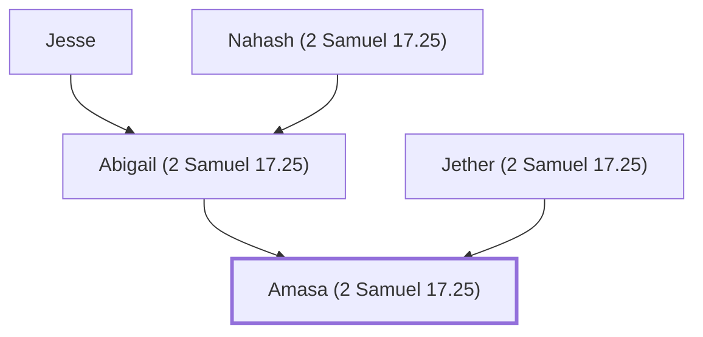

# Amasa (2 Samuel 17.25)

Military commander, son of Abigail (David's sister), killed by Joab

**Original-language names:** עֲמָשָׂא (H6021)

## When

- **Placed around:** [[connections/timeline/11th century BC|1022 BC]] *(Ussher: the median date of the passages naming them)*

## Family

- **Father:** [[connections/people/Jether (2 Samuel 17.25)|Jether (2 Samuel 17.25)]]
- **Mother:** [[connections/people/Abigail (2 Samuel 17.25)|Abigail (2 Samuel 17.25)]]
- **Tribe or nation:** Arabia

**Family group:** [[connections/genealogy/Family of Adam|Family of Adam]], generation 37

## Appears in

[[connections/chapters/10-2-samuel/2 Samuel 17|2 Samuel 17]] · [[connections/chapters/10-2-samuel/2 Samuel 19|2 Samuel 19]] · [[connections/chapters/10-2-samuel/2 Samuel 20|2 Samuel 20 (6)]] · [[connections/chapters/11-1-kings/1 Kings 2|1 Kings 2 (2)]] · [[connections/chapters/13-1-chronicles/1 Chronicles 2|1 Chronicles 2]]

## Appears in the same verse as

[[connections/people/Joab (1 Samuel 26.6)|Joab (1 Samuel 26.6) (6)]] · [[connections/people/Jether (2 Samuel 17.25)|Jether (2 Samuel 17.25) (4)]] · [[connections/people/Judah (Genesis 29.35)|Judah (Genesis 29.35) (3)]] · [[connections/people/Abigail (2 Samuel 17.25)|Abigail (2 Samuel 17.25) (2)]] · [[connections/people/Abner|Abner (2)]] · [[connections/people/Israel|Israel (2)]] · [[connections/people/Ner|Ner (2)]] · [[connections/people/Zeruiah|Zeruiah (2)]] · [[connections/people/Abishai|Abishai]] · [[connections/people/Absalom|Absalom]] · [[connections/people/Bichri|Bichri]] · [[connections/people/David|David]] · [[connections/people/Nahash (2 Samuel 17.25)|Nahash (2 Samuel 17.25)]] · [[connections/people/Sheba (2 Samuel 20.1)|Sheba (2 Samuel 20.1)]] · [[connections/places/Gibeon|Gibeon]]
