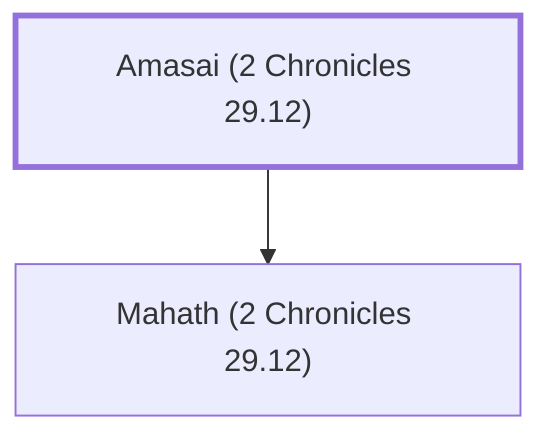

# Amasai (2 Chronicles 29.12)

Levite who helped purify the temple

**Original-language names:** עֲמָשַׂי (H6022)

## When

- **Placed around:** [[connections/timeline/8th century BC|726 BC]] *(Ussher: the median date of the passages naming them)*

## Family

- **Children:** [[connections/people/Mahath (2 Chronicles 29.12)|Mahath (2 Chronicles 29.12)]]

**Family group:** [[connections/genealogy/Family of Amasai (2 Chronicles 29.12)|Family of Amasai (2 Chronicles 29.12)]], generation 1

## Appears in

[[connections/chapters/14-2-chronicles/2 Chronicles 29|2 Chronicles 29]]

## Appears in the same verse as

[[connections/people/Abdi (2 Chronicles 29.12)|Abdi (2 Chronicles 29.12)]] · [[connections/people/Azariah (2 Chronicles 29.12)|Azariah (2 Chronicles 29.12)]] · [[connections/people/Azariah (2 Chronicles 29.12)|Azariah (2 Chronicles 29.12)]] · [[connections/people/Eden (2 Chronicles 29.12)|Eden (2 Chronicles 29.12)]] · [[connections/people/Jehallelel (2 Chronicles 29.12)|Jehallelel (2 Chronicles 29.12)]] · [[connections/people/Joah (2 Chronicles 29.12)|Joah (2 Chronicles 29.12)]] · [[connections/people/Joah (2 Chronicles 29.12)|Joah (2 Chronicles 29.12)]] · [[connections/people/Joel (2 Chronicles 29.12)|Joel (2 Chronicles 29.12)]] · [[connections/people/Kish (2 Chronicles 29.12)|Kish (2 Chronicles 29.12)]] · [[connections/people/Mahath (2 Chronicles 29.12)|Mahath (2 Chronicles 29.12)]] · [[connections/people/Merari|Merari]] · [[connections/people/Zimmah (2 Chronicles 29.12)|Zimmah (2 Chronicles 29.12)]]
