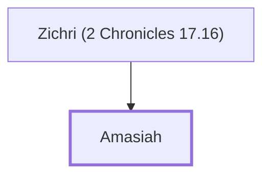

# Amasiah

Commander who volunteered for God's service

**Original-language names:** עֲמַסְיָה (H6007)

## When

- **Placed around:** [[connections/timeline/10th century BC|912 BC]] *(Ussher: the median date of the passages naming them)*

## Family

- **Father:** [[connections/people/Zichri (2 Chronicles 17.16)|Zichri (2 Chronicles 17.16)]]

**Family group:** [[connections/genealogy/Family of Zichri (2 Chronicles 17.16)|Family of Zichri (2 Chronicles 17.16)]], generation 2

## Appears in

[[connections/chapters/14-2-chronicles/2 Chronicles 17|2 Chronicles 17]]

## Appears in the same verse as

[[connections/people/Zichri (2 Chronicles 17.16)|Zichri (2 Chronicles 17.16)]]
