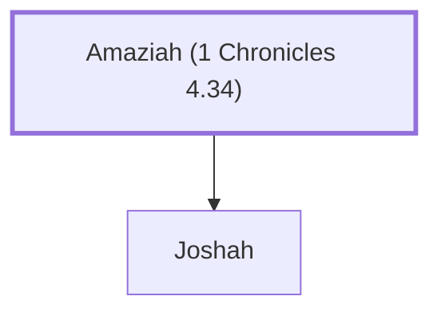

# Amaziah (1 Chronicles 4.34)

Simeonite, son of Joshah

**Original-language names:** אֲמַצְיָ֫הוּ (H0558)

## When

- **Placed around:** [[connections/timeline/18th century BC|1721 BC]] *(Ussher: the median date of the passages naming them)*

## Family

- **Children:** [[connections/people/Joshah|Joshah]]
- **Tribe or nation:** Tribe of Simeon

**Family group:** [[connections/genealogy/Family of Amaziah (1 Chronicles 4.34)|Family of Amaziah (1 Chronicles 4.34)]], generation 1

## Appears in

[[connections/chapters/13-1-chronicles/1 Chronicles 4|1 Chronicles 4]]

## Appears in the same verse as

[[connections/people/Jamlech|Jamlech]] · [[connections/people/Joshah|Joshah]] · [[connections/people/Meshobab|Meshobab]]
