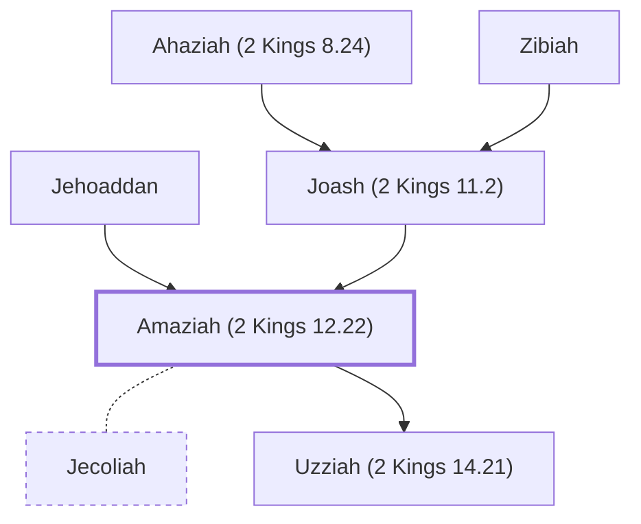

# Amaziah (2 Kings 12.22)

King of Judah, son of Joash

**Original-language names:** אֲמַצְיָ֫הוּ (H0558)

## When

- **Lived:** [[connections/timeline/9th century BC|863 BC]] – [[connections/timeline/9th century BC|810 BC]] *(Jones)*
- **Placed around:** [[connections/timeline/9th century BC|826 BC]] *(Ussher: the median date of the passages naming them)*

## Family

- **Father:** [[connections/people/Joash (2 Kings 11.2)|Joash (2 Kings 11.2)]]
- **Mother:** [[connections/people/Jehoaddan|Jehoaddan]]
- **Spouses:** [[connections/people/Jecoliah|Jecoliah]]
- **Children:** [[connections/people/Uzziah (2 Kings 14.21)|Uzziah (2 Kings 14.21)]]
- **Tribe or nation:** Tribe of Judah

**Line of descent** (43 generations, father to son): [[connections/people/Adam|Adam]] → [[connections/people/Seth|Seth]] → [[connections/people/Enosh|Enosh]] → [[connections/people/Kenan|Kenan]] → [[connections/people/Mahalalel (Genesis 5.12)|Mahalalel (Genesis 5.12)]] → [[connections/people/Jared|Jared]] → [[connections/people/Enoch (Genesis 5.18)|Enoch (Genesis 5.18)]] → [[connections/people/Methuselah|Methuselah]] → [[connections/people/Lamech (Genesis 5.25)|Lamech (Genesis 5.25)]] → [[connections/people/Noah (Genesis 5.29)|Noah (Genesis 5.29)]] → [[connections/people/Shem|Shem]] → [[connections/people/Arpachshad|Arpachshad]] → [[connections/people/Cainan|Cainan]] → [[connections/people/Shelah (Genesis 10.24)|Shelah (Genesis 10.24)]] → [[connections/people/Eber (Genesis 10.21)|Eber (Genesis 10.21)]] → [[connections/people/Peleg|Peleg]] → [[connections/people/Reu|Reu]] → [[connections/people/Serug|Serug]] → [[connections/people/Nahor (Genesis 11.22)|Nahor (Genesis 11.22)]] → [[connections/people/Terah|Terah]] → [[connections/people/Abraham|Abraham]] → [[connections/people/Isaac|Isaac]] → [[connections/people/Israel|Israel]] → [[connections/people/Judah (Genesis 29.35)|Judah (Genesis 29.35)]] → [[connections/people/Perez|Perez]] → [[connections/people/Hezron (Genesis 46.12)|Hezron (Genesis 46.12)]] → [[connections/people/Ram (Ruth 4.19)|Ram (Ruth 4.19)]] → [[connections/people/Amminadab (Exodus 6.23)|Amminadab (Exodus 6.23)]] → [[connections/people/Nahshon|Nahshon]] → [[connections/people/Salmon|Salmon]] → [[connections/people/Boaz|Boaz]] → [[connections/people/Obed (Ruth 4.17)|Obed (Ruth 4.17)]] → [[connections/people/Jesse|Jesse]] → [[connections/people/David|David]] → [[connections/people/Solomon|Solomon]] → [[connections/people/Rehoboam|Rehoboam]] → [[connections/people/Abijah (1 Kings 14.31)|Abijah (1 Kings 14.31)]] → [[connections/people/Asa (1 Kings 15.8)|Asa (1 Kings 15.8)]] → [[connections/people/Jehoshaphat (1 Kings 15.24)|Jehoshaphat (1 Kings 15.24)]] → [[connections/people/Jehoram (1 Kings 22.51)|Jehoram (1 Kings 22.51)]] → [[connections/people/Ahaziah (2 Kings 8.24)|Ahaziah (2 Kings 8.24)]] → [[connections/people/Joash (2 Kings 11.2)|Joash (2 Kings 11.2)]] → **Amaziah (2 Kings 12.22)**

**Family group:** [[connections/genealogy/Family of Adam|Family of Adam]], generation 43

## Events

- [[connections/timeline/9th century BC|839 BC]] · [[connections/events/Reign of Amaziah|Reign of Amaziah]]
- [[connections/timeline/9th century BC|810 BC]] · [[connections/events/Death of Amaziah|Death of Amaziah]]

## Appears in

[[connections/chapters/12-2-kings/2 Kings 12|2 Kings 12]] · [[connections/chapters/12-2-kings/2 Kings 13|2 Kings 13]] · [[connections/chapters/12-2-kings/2 Kings 14|2 Kings 14 (10)]] · [[connections/chapters/12-2-kings/2 Kings 15|2 Kings 15 (2)]] · [[connections/chapters/13-1-chronicles/1 Chronicles 3|1 Chronicles 3]] · [[connections/chapters/14-2-chronicles/2 Chronicles 24|2 Chronicles 24]] · [[connections/chapters/14-2-chronicles/2 Chronicles 25|2 Chronicles 25 (16)]] · [[connections/chapters/14-2-chronicles/2 Chronicles 26|2 Chronicles 26 (2)]]

## Appears in the same verse as

[[connections/people/Judah (Genesis 29.35)|Judah (Genesis 29.35) (21)]] · [[connections/people/Israel|Israel (17)]] · [[connections/people/Joash (2 Kings 13.9)|Joash (2 Kings 13.9) (14)]] · [[connections/people/Joash (2 Kings 11.2)|Joash (2 Kings 11.2) (6)]] · [[connections/people/Jehoahaz (2 Kings 10.35)|Jehoahaz (2 Kings 10.35) (5)]] · [[connections/people/Uzziah (2 Kings 14.21)|Uzziah (2 Kings 14.21) (4)]] · [[connections/places/Beth-shemesh (Joshua 15.10)|Beth-shemesh (Joshua 15.10) (4)]] · [[connections/places/Jerusalem|Jerusalem (4)]] · [[connections/people/Ahaziah (2 Kings 8.24)|Ahaziah (2 Kings 8.24) (2)]] · [[connections/people/Jehu (1 Kings 19.16)|Jehu (1 Kings 19.16) (2)]] · [[connections/people/Jeroboam (2 Kings 13.13)|Jeroboam (2 Kings 13.13) (2)]] · [[connections/places/Corner Gate|Corner Gate (2)]] · [[connections/places/Ephraim Gate|Ephraim Gate (2)]] · [[connections/places/Lebanon|Lebanon (2)]] · [[connections/places/Samaria|Samaria (2)]] · [[connections/places/Seir|Seir (2)]] · [[connections/people/Benjamin (Genesis 35.18)|Benjamin (Genesis 35.18)]] · [[connections/people/David|David]] · [[connections/people/Ephraim|Ephraim]] · [[connections/people/Jehoaddan|Jehoaddan]] · [[connections/people/Jehozabad (2 Kings 12.22)|Jehozabad (2 Kings 12.22)]] · [[connections/people/Jotham (2 Kings 15.5)|Jotham (2 Kings 15.5)]] · [[connections/people/Jozacar|Jozacar]] · [[connections/people/Shimeath|Shimeath]] · [[connections/people/Shomer (2 Kings 12.22)|Shomer (2 Kings 12.22)]] · [[connections/places/Beth-horon Lower|Beth-horon Lower]] · [[connections/places/Edom|Edom]] · [[connections/places/Lachish|Lachish]] · [[connections/places/Salt Valley|Salt Valley]]
