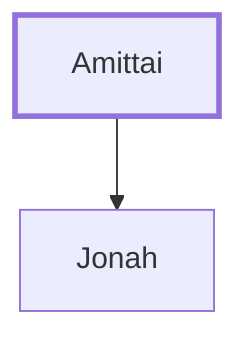

# Amittai

Father of the prophet Jonah

**Original-language names:** אֲמִתַּי (H0573)

## When

- **Placed around:** [[connections/timeline/9th century BC|825 BC]] *(Ussher: the median date of the passages naming them)*

## Family

- **Children:** [[connections/people/Jonah|Jonah]]

**Family group:** [[connections/genealogy/Family of Amittai|Family of Amittai]], generation 1

## Appears in

[[connections/chapters/12-2-kings/2 Kings 14|2 Kings 14]] · [[connections/chapters/32-jonah/Jonah 1|Jonah 1]]

## Appears in the same verse as

[[connections/people/Jonah|Jonah (2)]] · [[connections/people/Israel|Israel]] · [[connections/places/Gath-hepher|Gath-hepher]] · [[connections/places/Hamath|Hamath]] · [[connections/places/Salt Sea|Salt Sea]]
