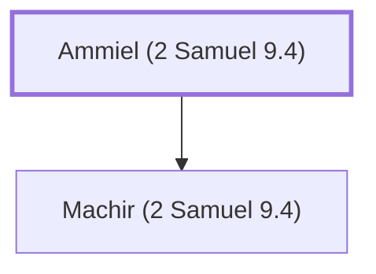

# Ammiel (2 Samuel 9.4)

Father of Machir, David's ally

**Original-language names:** עַמִּיאֵל (H5988)

## When

- **Placed around:** [[connections/timeline/11th century BC|1040 BC]] *(Ussher: the median date of the passages naming them)*

## Family

- **Children:** [[connections/people/Machir (2 Samuel 9.4)|Machir (2 Samuel 9.4)]]

**Family group:** [[connections/genealogy/Family of Ammiel (2 Samuel 9.4)|Family of Ammiel (2 Samuel 9.4)]], generation 1

## Appears in

[[connections/chapters/10-2-samuel/2 Samuel 9|2 Samuel 9 (2)]] · [[connections/chapters/10-2-samuel/2 Samuel 17|2 Samuel 17]]

## Appears in the same verse as

[[connections/people/Machir (2 Samuel 9.4)|Machir (2 Samuel 9.4) (3)]] · [[connections/places/Lo-debar|Lo-debar (3)]] · [[connections/people/David|David (2)]] · [[connections/people/Barzillai (2 Samuel 17.27)|Barzillai (2 Samuel 17.27)]] · [[connections/people/Nahash (2 Samuel 17.27)|Nahash (2 Samuel 17.27)]] · [[connections/people/Shobi|Shobi]] · [[connections/people/Ziba|Ziba]] · [[connections/places/Ammon|Ammon]] · [[connections/places/Mahanaim|Mahanaim]] · [[connections/places/Rogelim|Rogelim]]
