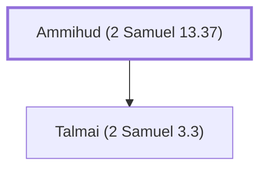

# Ammihud (2 Samuel 13.37)

Father of Talmai, king of Geshur

**Original-language names:** עַמִּיהוּד (H5989)

## When

- **Placed around:** [[connections/timeline/11th century BC|1030 BC]] *(Ussher: the median date of the passages naming them)*

## Family

- **Children:** [[connections/people/Talmai (2 Samuel 3.3)|Talmai (2 Samuel 3.3)]]

**Family group:** [[connections/genealogy/Family of Adam|Family of Adam]], generation 1

## Appears in

[[connections/chapters/10-2-samuel/2 Samuel 13|2 Samuel 13]]

## Appears in the same verse as

[[connections/people/Absalom|Absalom]] · [[connections/people/Talmai (2 Samuel 3.3)|Talmai (2 Samuel 3.3)]] · [[connections/places/Geshur|Geshur]]
