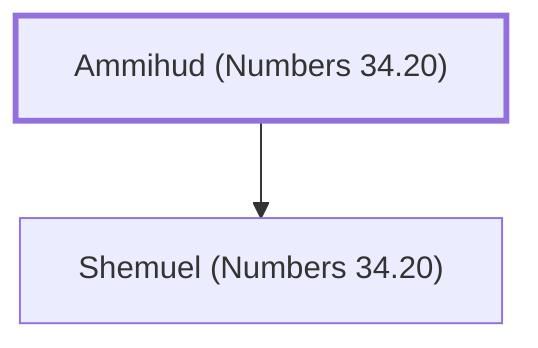

# Ammihud (Numbers 34.20)

Father of Shemuel, leader from Simeon

**Original-language names:** עַמִּיהוּד (H5989)

## When

- **Placed around:** [[connections/timeline/15th century BC|1452 BC]] *(Ussher: the median date of the passages naming them)*

## Family

- **Children:** [[connections/people/Shemuel (Numbers 34.20)|Shemuel (Numbers 34.20)]]

**Family group:** [[connections/genealogy/Family of Ammihud (Numbers 34.20)|Family of Ammihud (Numbers 34.20)]], generation 1

## Appears in

[[connections/chapters/04-numbers/Numbers 34|Numbers 34]]

## Appears in the same verse as

[[connections/people/Shemuel (Numbers 34.20)|Shemuel (Numbers 34.20)]] · [[connections/people/Simeon (Genesis 29.33)|Simeon (Genesis 29.33)]]
