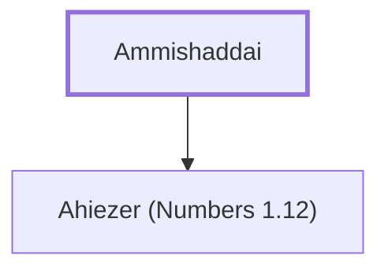

# Ammishaddai

Father of Ahiezer, leader of Dan

**Original-language names:** עַמִּישַׁדָּ֑י (H5996)

## When

- **Placed around:** [[connections/timeline/15th century BC|1490 BC]] *(Ussher: the median date of the passages naming them)*

## Family

- **Children:** [[connections/people/Ahiezer (Numbers 1.12)|Ahiezer (Numbers 1.12)]]
- **Tribe or nation:** Tribe of Dan

**Family group:** [[connections/genealogy/Family of Ammishaddai|Family of Ammishaddai]], generation 1

## Appears in

[[connections/chapters/04-numbers/Numbers 1|Numbers 1]] · [[connections/chapters/04-numbers/Numbers 2|Numbers 2]] · [[connections/chapters/04-numbers/Numbers 7|Numbers 7 (2)]] · [[connections/chapters/04-numbers/Numbers 10|Numbers 10]]

## Appears in the same verse as

[[connections/people/Ahiezer (Numbers 1.12)|Ahiezer (Numbers 1.12) (5)]] · [[connections/places/Dan|Dan (4)]]
