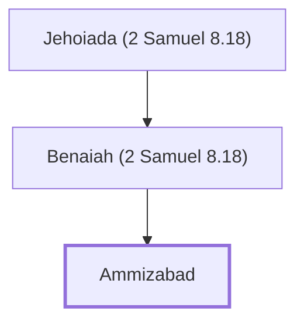

# Ammizabad

Son of Benaiah, one of David's mighty men

**Original-language names:** עַמִּיזָבָד (H5990)

## When

- **Placed around:** [[connections/timeline/11th century BC|1015 BC]] *(Ussher: the median date of the passages naming them)*

## Family

- **Father:** [[connections/people/Benaiah (2 Samuel 8.18)|Benaiah (2 Samuel 8.18)]]
- **Tribe or nation:** Tribe of Judah

**Line of descent** (3 generations, father to son): [[connections/people/Jehoiada (2 Samuel 8.18)|Jehoiada (2 Samuel 8.18)]] → [[connections/people/Benaiah (2 Samuel 8.18)|Benaiah (2 Samuel 8.18)]] → **Ammizabad**

**Family group:** [[connections/genealogy/Family of Jehoiada (2 Samuel 8.18)|Family of Jehoiada (2 Samuel 8.18)]], generation 3

## Appears in

[[connections/chapters/13-1-chronicles/1 Chronicles 27|1 Chronicles 27]]

## Appears in the same verse as

[[connections/people/Benaiah (2 Samuel 8.18)|Benaiah (2 Samuel 8.18)]]
