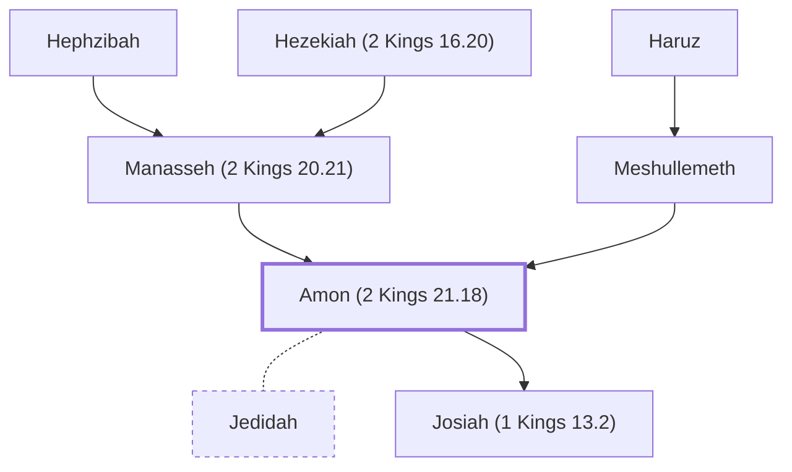

# Amon (2 Kings 21.18)

King of Judah, son of Manasseh

**Also called:** Amos

**Original-language names:** אָמוֹן (H0526) · Ἀμών (G0300) · Ἀμώς (G0301)

## When

- **Lived:** ? – [[connections/timeline/7th century BC|640 BC]] *(Jones)*
- **Placed around:** [[connections/timeline/7th century BC|641 BC]] *(Ussher: the median date of the passages naming them)*

## Family

- **Father:** [[connections/people/Manasseh (2 Kings 20.21)|Manasseh (2 Kings 20.21)]]
- **Mother:** [[connections/people/Meshullemeth|Meshullemeth]]
- **Spouses:** [[connections/people/Jedidah|Jedidah]]
- **Children:** [[connections/people/Josiah (1 Kings 13.2)|Josiah (1 Kings 13.2)]]
- **Tribe or nation:** Tribe of Judah

**Line of descent** (49 generations, father to son): [[connections/people/Adam|Adam]] → [[connections/people/Seth|Seth]] → [[connections/people/Enosh|Enosh]] → [[connections/people/Kenan|Kenan]] → [[connections/people/Mahalalel (Genesis 5.12)|Mahalalel (Genesis 5.12)]] → [[connections/people/Jared|Jared]] → [[connections/people/Enoch (Genesis 5.18)|Enoch (Genesis 5.18)]] → [[connections/people/Methuselah|Methuselah]] → [[connections/people/Lamech (Genesis 5.25)|Lamech (Genesis 5.25)]] → [[connections/people/Noah (Genesis 5.29)|Noah (Genesis 5.29)]] → [[connections/people/Shem|Shem]] → [[connections/people/Arpachshad|Arpachshad]] → [[connections/people/Cainan|Cainan]] → [[connections/people/Shelah (Genesis 10.24)|Shelah (Genesis 10.24)]] → [[connections/people/Eber (Genesis 10.21)|Eber (Genesis 10.21)]] → [[connections/people/Peleg|Peleg]] → [[connections/people/Reu|Reu]] → [[connections/people/Serug|Serug]] → [[connections/people/Nahor (Genesis 11.22)|Nahor (Genesis 11.22)]] → [[connections/people/Terah|Terah]] → [[connections/people/Abraham|Abraham]] → [[connections/people/Isaac|Isaac]] → [[connections/people/Israel|Israel]] → [[connections/people/Judah (Genesis 29.35)|Judah (Genesis 29.35)]] → [[connections/people/Perez|Perez]] → [[connections/people/Hezron (Genesis 46.12)|Hezron (Genesis 46.12)]] → [[connections/people/Ram (Ruth 4.19)|Ram (Ruth 4.19)]] → [[connections/people/Amminadab (Exodus 6.23)|Amminadab (Exodus 6.23)]] → [[connections/people/Nahshon|Nahshon]] → [[connections/people/Salmon|Salmon]] → [[connections/people/Boaz|Boaz]] → [[connections/people/Obed (Ruth 4.17)|Obed (Ruth 4.17)]] → [[connections/people/Jesse|Jesse]] → [[connections/people/David|David]] → [[connections/people/Solomon|Solomon]] → [[connections/people/Rehoboam|Rehoboam]] → [[connections/people/Abijah (1 Kings 14.31)|Abijah (1 Kings 14.31)]] → [[connections/people/Asa (1 Kings 15.8)|Asa (1 Kings 15.8)]] → [[connections/people/Jehoshaphat (1 Kings 15.24)|Jehoshaphat (1 Kings 15.24)]] → [[connections/people/Jehoram (1 Kings 22.51)|Jehoram (1 Kings 22.51)]] → [[connections/people/Ahaziah (2 Kings 8.24)|Ahaziah (2 Kings 8.24)]] → [[connections/people/Joash (2 Kings 11.2)|Joash (2 Kings 11.2)]] → [[connections/people/Amaziah (2 Kings 12.22)|Amaziah (2 Kings 12.22)]] → [[connections/people/Uzziah (2 Kings 14.21)|Uzziah (2 Kings 14.21)]] → [[connections/people/Jotham (2 Kings 15.5)|Jotham (2 Kings 15.5)]] → [[connections/people/Ahaz (2 Kings 15.38)|Ahaz (2 Kings 15.38)]] → [[connections/people/Hezekiah (2 Kings 16.20)|Hezekiah (2 Kings 16.20)]] → [[connections/people/Manasseh (2 Kings 20.21)|Manasseh (2 Kings 20.21)]] → **Amon (2 Kings 21.18)**

**Family group:** [[connections/genealogy/Family of Adam|Family of Adam]], generation 49

## Events

- [[connections/timeline/7th century BC|642 BC]] · [[connections/events/Reign of Amon|Reign of Amon]]
- [[connections/timeline/7th century BC|640 BC]] · [[connections/events/Death of Amon|Death of Amon]]

## Appears in

[[connections/chapters/12-2-kings/2 Kings 21|2 Kings 21 (5)]] · [[connections/chapters/13-1-chronicles/1 Chronicles 3|1 Chronicles 3]] · [[connections/chapters/14-2-chronicles/2 Chronicles 33|2 Chronicles 33 (5)]] · [[connections/chapters/24-jeremiah/Jeremiah 1|Jeremiah 1]] · [[connections/chapters/24-jeremiah/Jeremiah 25|Jeremiah 25]] · [[connections/chapters/36-zephaniah/Zephaniah 1|Zephaniah 1]] · [[connections/chapters/40-matthew/Matthew 1|Matthew 1]]

## Appears in the same verse as

[[connections/people/Josiah (1 Kings 13.2)|Josiah (1 Kings 13.2) (7)]] · [[connections/people/Manasseh (2 Kings 20.21)|Manasseh (2 Kings 20.21) (5)]] · [[connections/people/Judah (Genesis 29.35)|Judah (Genesis 29.35) (4)]] · [[connections/places/Jerusalem|Jerusalem (2)]] · [[connections/people/Amariah (Zephaniah 1.1)|Amariah (Zephaniah 1.1)]] · [[connections/people/Cushi (Zephaniah 1.1)|Cushi (Zephaniah 1.1)]] · [[connections/people/Gedaliah (Zephaniah 1.1)|Gedaliah (Zephaniah 1.1)]] · [[connections/people/Haruz|Haruz]] · [[connections/people/Hezekiah (2 Kings 16.20)|Hezekiah (2 Kings 16.20)]] · [[connections/people/Hezekiah (Zephaniah 1.1)|Hezekiah (Zephaniah 1.1)]] · [[connections/people/Meshullemeth|Meshullemeth]] · [[connections/people/Zephaniah (Zephaniah 1.1)|Zephaniah (Zephaniah 1.1)]] · [[connections/places/Jotbah|Jotbah]] · [[connections/places/Uzza|Uzza]]
