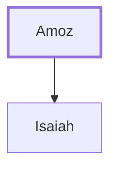

# Amoz

Father of the prophet Isaiah

**Original-language names:** אָמוֹץ (H0531)

## When

- **Placed around:** [[connections/timeline/8th century BC|713 BC]] *(Ussher: the median date of the passages naming them)*

## Family

- **Children:** [[connections/people/Isaiah|Isaiah]]

**Family group:** [[connections/genealogy/Family of Amoz|Family of Amoz]], generation 1

## Appears in

[[connections/chapters/12-2-kings/2 Kings 19|2 Kings 19 (2)]] · [[connections/chapters/12-2-kings/2 Kings 20|2 Kings 20]] · [[connections/chapters/14-2-chronicles/2 Chronicles 26|2 Chronicles 26]] · [[connections/chapters/14-2-chronicles/2 Chronicles 32|2 Chronicles 32 (2)]] · [[connections/chapters/23-isaiah/Isaiah 1|Isaiah 1]] · [[connections/chapters/23-isaiah/Isaiah 2|Isaiah 2]] · [[connections/chapters/23-isaiah/Isaiah 13|Isaiah 13]] · [[connections/chapters/23-isaiah/Isaiah 20|Isaiah 20]] · [[connections/chapters/23-isaiah/Isaiah 37|Isaiah 37 (2)]] · [[connections/chapters/23-isaiah/Isaiah 38|Isaiah 38]]

## Appears in the same verse as

[[connections/people/Isaiah|Isaiah (13)]] · [[connections/people/Hezekiah (2 Kings 16.20)|Hezekiah (2 Kings 16.20) (7)]] · [[connections/people/Israel|Israel (3)]] · [[connections/people/Judah (Genesis 29.35)|Judah (Genesis 29.35) (3)]] · [[connections/people/Eliakim (2 Kings 18.18)|Eliakim (2 Kings 18.18) (2)]] · [[connections/people/Sennacherib|Sennacherib (2)]] · [[connections/people/Shebna|Shebna (2)]] · [[connections/people/Uzziah (2 Kings 14.21)|Uzziah (2 Kings 14.21) (2)]] · [[connections/places/Assyria|Assyria (2)]] · [[connections/places/Jerusalem|Jerusalem (2)]] · [[connections/people/Ahaz (2 Kings 15.38)|Ahaz (2 Kings 15.38)]] · [[connections/people/Jotham (2 Kings 15.5)|Jotham (2 Kings 15.5)]] · [[connections/places/Babylon|Babylon]]
