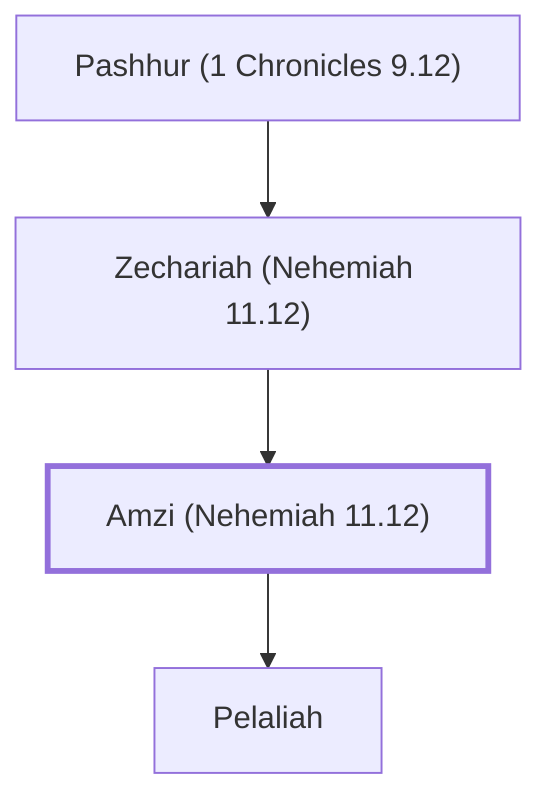

# Amzi (Nehemiah 11.12)

Priest in Jerusalem after the Exile

**Original-language names:** אַמְצִי (H0557)

## When

- **Placed around:** [[connections/timeline/5th century BC|445 BC]] *(Ussher: the median date of the passages naming them)*

## Family

- **Father:** [[connections/people/Zechariah (Nehemiah 11.12)|Zechariah (Nehemiah 11.12)]]
- **Children:** [[connections/people/Pelaliah|Pelaliah]]
- **Tribe or nation:** Tribe of Levi

**Line of descent** (5 generations, father to son): [[connections/people/Hammelech|Hammelech]] → [[connections/people/Malchijah (1 Chronicles 9.12)|Malchijah (1 Chronicles 9.12)]] → [[connections/people/Pashhur (1 Chronicles 9.12)|Pashhur (1 Chronicles 9.12)]] → [[connections/people/Zechariah (Nehemiah 11.12)|Zechariah (Nehemiah 11.12)]] → **Amzi (Nehemiah 11.12)**

**Family group:** [[connections/genealogy/Family of Hammelech|Family of Hammelech]], generation 5

## Appears in

[[connections/chapters/16-nehemiah/Nehemiah 11|Nehemiah 11]]

## Appears in the same verse as

[[connections/people/Adaiah (1 Chronicles 9.12)|Adaiah (1 Chronicles 9.12)]] · [[connections/people/Jeroham (1 Chronicles 9.12)|Jeroham (1 Chronicles 9.12)]] · [[connections/people/Malchijah (1 Chronicles 9.12)|Malchijah (1 Chronicles 9.12)]] · [[connections/people/Pashhur (1 Chronicles 9.12)|Pashhur (1 Chronicles 9.12)]] · [[connections/people/Pelaliah|Pelaliah]] · [[connections/people/Zechariah (Nehemiah 11.12)|Zechariah (Nehemiah 11.12)]]
