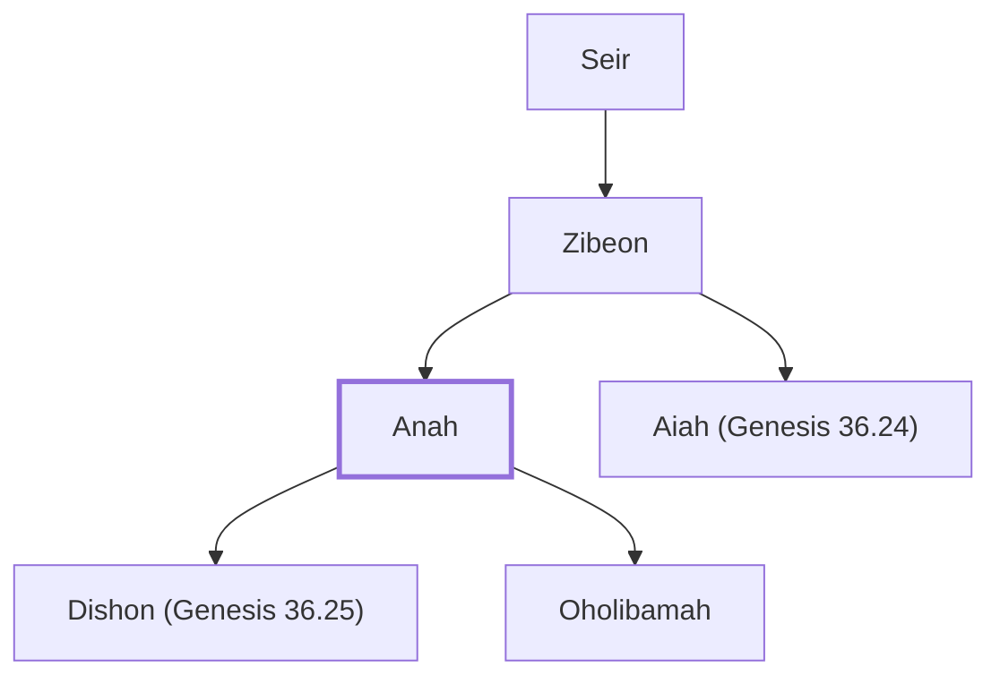

# Anah

Horite, father of Oholibamah, Esau's wife

**Original-language names:** עֲנָה (H6034)

## When

- **Placed around:** [[connections/timeline/18th century BC|1756 BC]] *(Ussher: the median date of the passages naming them)*

## Family

- **Father:** [[connections/people/Zibeon|Zibeon]]
- **Brothers and sisters:** [[connections/people/Aiah (Genesis 36.24)|Aiah (Genesis 36.24)]]
- **Children:** [[connections/people/Dishon (Genesis 36.25)|Dishon (Genesis 36.25)]], [[connections/people/Oholibamah|Oholibamah]]
- **Tribe or nation:** Edom

**Line of descent** (3 generations, father to son): [[connections/people/Seir|Seir]] → [[connections/people/Zibeon|Zibeon]] → **Anah**

**Family group:** [[connections/genealogy/Family of Adam|Family of Adam]], generation 3

## Appears in

[[connections/chapters/01-genesis/Genesis 36|Genesis 36 (7)]] · [[connections/chapters/13-1-chronicles/1 Chronicles 1|1 Chronicles 1 (3)]]

## Appears in the same verse as

[[connections/people/Oholibamah|Oholibamah (4)]] · [[connections/people/Shobal (Genesis 36.20)|Shobal (Genesis 36.20) (4)]] · [[connections/people/Esau|Esau (3)]] · [[connections/people/Lotan|Lotan (3)]] · [[connections/people/Aiah (Genesis 36.24)|Aiah (Genesis 36.24) (2)]] · [[connections/people/Dishon (Genesis 36.21)|Dishon (Genesis 36.21) (2)]] · [[connections/people/Dishon (Genesis 36.25)|Dishon (Genesis 36.25) (2)]] · [[connections/people/Jalam|Jalam (2)]] · [[connections/people/Jeush (Genesis 36.5)|Jeush (Genesis 36.5) (2)]] · [[connections/people/Korah (Genesis 36.5)|Korah (Genesis 36.5) (2)]] · [[connections/people/Seir|Seir (2)]] · [[connections/people/Zibeon|Zibeon (2)]] · [[connections/people/Adah (Genesis 26.34)|Adah (Genesis 26.34)]] · [[connections/people/Alvan|Alvan]] · [[connections/people/Cheran|Cheran]] · [[connections/people/Dishan|Dishan]] · [[connections/people/Ebal|Ebal]] · [[connections/people/Elon (Genesis 26.34)|Elon (Genesis 26.34)]] · [[connections/people/Eshban|Eshban]] · [[connections/people/Ezer (Genesis 36.21)|Ezer (Genesis 36.21)]] · [[connections/people/Hemdan|Hemdan]] · [[connections/people/Ithran (Genesis 36.26)|Ithran (Genesis 36.26)]] · [[connections/people/Manahath|Manahath]] · [[connections/people/Onam (Genesis 36.23)|Onam (Genesis 36.23)]] · [[connections/people/Shepho|Shepho]] · [[connections/places/Canaan|Canaan]]
