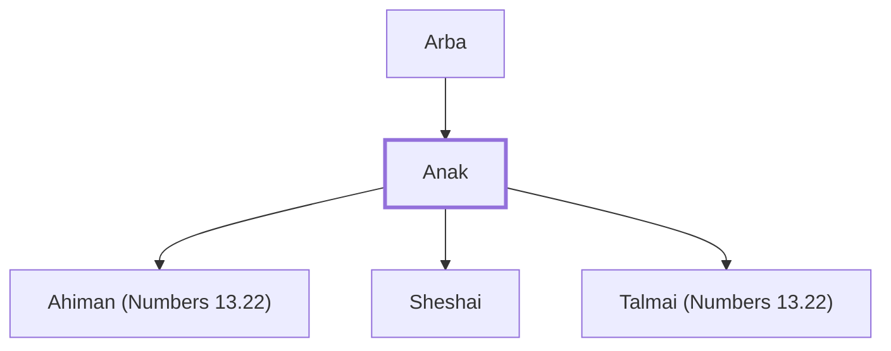

# Anak

Ancestor of giant people in Canaan

**Original-language names:** עֲנָק (H6061)

## When

- **Placed around:** [[connections/timeline/15th century BC|1451 BC]] *(Ussher: the median date of the passages naming them)*

## Family

- **Father:** [[connections/people/Arba|Arba]]
- **Children:** [[connections/people/Ahiman (Numbers 13.22)|Ahiman (Numbers 13.22)]], [[connections/people/Sheshai|Sheshai]], [[connections/people/Talmai (Numbers 13.22)|Talmai (Numbers 13.22)]]

**Family group:** [[connections/genealogy/Family of Arba|Family of Arba]], generation 2

## Appears in

[[connections/chapters/04-numbers/Numbers 13|Numbers 13 (3)]] · [[connections/chapters/05-deuteronomy/Deuteronomy 9|Deuteronomy 9]] · [[connections/chapters/06-joshua/Joshua 15|Joshua 15 (2)]] · [[connections/chapters/06-joshua/Joshua 21|Joshua 21]] · [[connections/chapters/07-judges/Judges 1|Judges 1]]

## Appears in the same verse as

[[connections/places/Hebron|Hebron (4)]] · [[connections/people/Caleb (Numbers 13.6)|Caleb (Numbers 13.6) (3)]] · [[connections/people/Ahiman (Numbers 13.22)|Ahiman (Numbers 13.22) (2)]] · [[connections/people/Arba|Arba (2)]] · [[connections/people/Judah (Genesis 29.35)|Judah (Genesis 29.35) (2)]] · [[connections/people/Sheshai|Sheshai (2)]] · [[connections/people/Talmai (Numbers 13.22)|Talmai (Numbers 13.22) (2)]] · [[connections/people/Jephunneh (Numbers 13.6)|Jephunneh (Numbers 13.6)]] · [[connections/people/Joshua (Exodus 17.9)|Joshua (Exodus 17.9)]] · [[connections/people/Moses|Moses]] · [[connections/places/Egypt|Egypt]] · [[connections/places/Negeb|Negeb]] · [[connections/places/Zoan|Zoan]]
