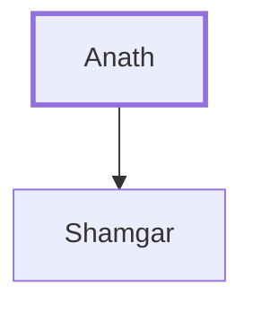

# Anath

Father of Shamgar, a judge of Israel

**Original-language names:** עֲנָת (H6067)

## When

- **Placed around:** [[connections/timeline/14th century BC|1325 BC]] *(Ussher: the median date of the passages naming them)*

## Family

- **Children:** [[connections/people/Shamgar|Shamgar]]

**Family group:** [[connections/genealogy/Family of Anath|Family of Anath]], generation 1

## Appears in

[[connections/chapters/07-judges/Judges 3|Judges 3]] · [[connections/chapters/07-judges/Judges 5|Judges 5]]

## Appears in the same verse as

[[connections/people/Shamgar|Shamgar (2)]] · [[connections/people/Israel|Israel]] · [[connections/people/Jael|Jael]]
