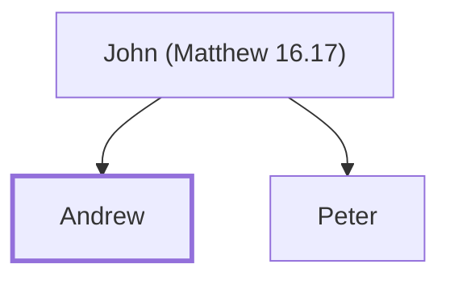

# Andrew

Apostle, brother of Simon Peter

**Original-language names:** Ἀνδρέας (G0406)

## When

- **Placed around:** [[connections/timeline/1st century AD|AD 31]] *(Ussher: the median date of the passages naming them)*

## Family

- **Father:** [[connections/people/John (Matthew 16.17)|John (Matthew 16.17)]]
- **Brothers and sisters:** [[connections/people/Peter|Peter]]

**Family group:** [[connections/genealogy/Family of John (Matthew 16.17)|Family of John (Matthew 16.17)]], generation 2

## Events

- [[connections/timeline/1st century AD|AD 27]] · [[connections/events/Fishers of Men|Fishers of Men]]
- [[connections/timeline/1st century AD|AD 27]] · [[connections/events/First Disciples Gathered|First Disciples Gathered]]
- [[connections/timeline/1st century AD|AD 28]] · [[connections/events/Apostles Chosen|Apostles Chosen]]
- [[connections/timeline/1st century AD|AD 29]] · [[connections/events/Feeding of Five Thousand|Feeding of Five Thousand]]
- [[connections/timeline/1st century AD|AD 30]] · [[connections/events/Olivet Discourse|Olivet Discourse]]
- [[connections/timeline/1st century AD|AD 30]] · [[connections/events/Matthias replaces Judas|Matthias replaces Judas]]

## Appears in

[[connections/chapters/40-matthew/Matthew 4|Matthew 4]] · [[connections/chapters/40-matthew/Matthew 10|Matthew 10]] · [[connections/chapters/41-mark/Mark 1|Mark 1 (2)]] · [[connections/chapters/41-mark/Mark 3|Mark 3]] · [[connections/chapters/41-mark/Mark 13|Mark 13]] · [[connections/chapters/42-luke/Luke 6|Luke 6]] · [[connections/chapters/43-john/John 1|John 1 (2)]] · [[connections/chapters/43-john/John 6|John 6]] · [[connections/chapters/43-john/John 12|John 12]] · [[connections/chapters/44-acts/Acts 1|Acts 1]]

## Appears in the same verse as

[[connections/people/Peter|Peter (10)]] · [[connections/people/James (Matthew 4.21)|James (Matthew 4.21) (5)]] · [[connections/people/John (Matthew 4.21)|John (Matthew 4.21) (5)]] · [[connections/people/Philip (Matthew 10.3)|Philip (Matthew 10.3) (5)]] · [[connections/people/Bartholomew|Bartholomew (3)]] · [[connections/people/Alphaeus|Alphaeus (2)]] · [[connections/people/James (Matthew 10.3)|James (Matthew 10.3) (2)]] · [[connections/people/Jesus|Jesus (2)]] · [[connections/people/Judas (Matthew 10.3)|Judas (Matthew 10.3) (2)]] · [[connections/people/Matthew|Matthew (2)]] · [[connections/people/Simon (Matthew 10.4)|Simon (Matthew 10.4) (2)]] · [[connections/people/Thomas|Thomas (2)]] · [[connections/places/Chinnereth|Chinnereth (2)]] · [[connections/people/James (Luke 6.16)|James (Luke 6.16)]] · [[connections/people/John (Matthew 3.1)|John (Matthew 3.1)]] · [[connections/people/Zebedee|Zebedee]] · [[connections/places/Bethsaida|Bethsaida]] · [[connections/places/Olives Mount|Olives Mount]]
