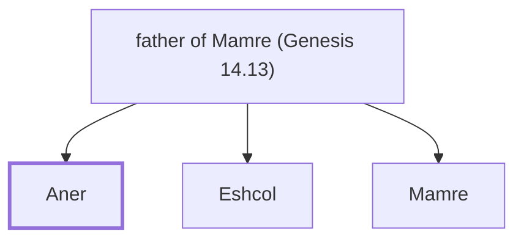

# Aner

Amorite ally of Abram

**Original-language names:** עָנֵר (H6063)

## When

- **Placed around:** [[connections/timeline/20th century BC|1913 BC]] *(Ussher: the median date of the passages naming them)*

## Family

- **Father:** [[connections/people/father of Mamre (Genesis 14.13)|father of Mamre (Genesis 14.13)]]
- **Brothers and sisters:** [[connections/people/Eshcol|Eshcol]], [[connections/people/Mamre|Mamre]]

**Family group:** [[connections/genealogy/Family of father of Mamre (Genesis 14.13)|Family of father of Mamre (Genesis 14.13)]], generation 2

## Appears in

[[connections/chapters/01-genesis/Genesis 14|Genesis 14 (2)]]

## Appears in the same verse as

[[connections/people/Eshcol|Eshcol (2)]] · [[connections/places/Mamre|Mamre (2)]] · [[connections/people/Abraham|Abraham]] · [[connections/people/Mamre|Mamre]]
