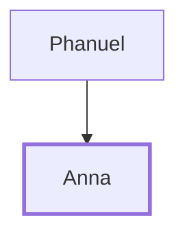

# Anna

Prophetess who witnessed Jesus' dedication in the temple

**Original-language names:** Ἄννα (G0451)

## When

- **Placed around:** [[connections/timeline/1st century AD|AD 4]] *(Ussher: the median date of the passages naming them)*

## Family

- **Father:** [[connections/people/Phanuel|Phanuel]]

**Family group:** [[connections/genealogy/Family of Phanuel|Family of Phanuel]], generation 2

## Appears in

[[connections/chapters/42-luke/Luke 2|Luke 2]]

## Appears in the same verse as

[[connections/people/Asher|Asher]] · [[connections/people/Phanuel|Phanuel]]
