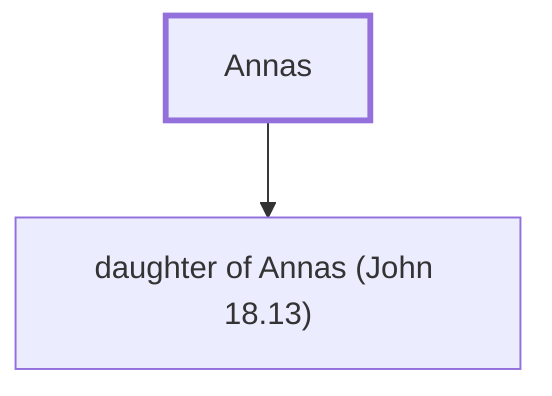

# Annas

High priest during Jesus' ministry and trial

**Original-language names:** Ἄννας (G0452)

## When

- **Placed around:** [[connections/timeline/1st century AD|AD 33]] *(Ussher: the median date of the passages naming them)*
- **Reigned / in office:** [[connections/timeline/1st century AD|AD 6]] – [[connections/timeline/1st century AD|AD 15]] *(modern dates)* · Annas, High priests · [Wikidata Q51680](https://www.wikidata.org/wiki/Q51680)

## Family

- **Children:** [[connections/people/daughter of Annas (John 18.13)|daughter of Annas (John 18.13)]]
- **Tribe or nation:** Tribe of Levi

**Family group:** [[connections/genealogy/Family of Annas|Family of Annas]], generation 1

## Events

- [[connections/timeline/1st century AD|AD 30]] · [[connections/events/Peter and John's Trial|Peter and John's Trial]]

## Appears in

[[connections/chapters/42-luke/Luke 3|Luke 3]] · [[connections/chapters/43-john/John 18|John 18 (2)]] · [[connections/chapters/44-acts/Acts 4|Acts 4]]

## Appears in the same verse as

[[connections/people/Caiaphas|Caiaphas (4)]] · [[connections/people/Alexander (Acts 4.6)|Alexander (Acts 4.6)]] · [[connections/people/John (Acts 4.6)|John (Acts 4.6)]] · [[connections/people/John (Matthew 3.1)|John (Matthew 3.1)]] · [[connections/people/Zechariah (Luke 1.5)|Zechariah (Luke 1.5)]]
