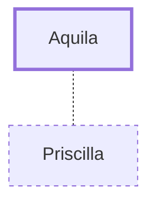

# Aquila

Jewish Christian tentmaker, co-worker with Paul

**Original-language names:** Ἀκύλας (G0207)

## When

- **Placed around:** [[connections/timeline/1st century AD|AD 59]] *(Ussher: the median date of the passages naming them)*

## Family

- **Spouses:** [[connections/people/Priscilla|Priscilla]]

## Events

- [[connections/timeline/1st century AD|AD 46]] · [[connections/events/Second Missionary Journey|Second Missionary Journey]]
- [[connections/timeline/1st century AD|AD 49]] · [[connections/events/Mission to Corinth, 1&2 Thess Written|Mission to Corinth, 1&2 Thess Written]]
- [[connections/timeline/1st century AD|AD 50]] · [[connections/events/Return from Second Missionary Journey|Return from Second Missionary Journey]]
- [[connections/timeline/1st century AD|AD 50]] · [[connections/events/Third Missionary Journey Begins|Third Missionary Journey Begins]]
- [[connections/timeline/1st century AD|AD 50]] · [[connections/events/Third Missionary Journey|Third Missionary Journey]]

## Appears in

[[connections/chapters/44-acts/Acts 18|Acts 18 (3)]] · [[connections/chapters/45-romans/Romans 16|Romans 16]] · [[connections/chapters/46-1-corinthians/1 Corinthians 16|1 Corinthians 16]] · [[connections/chapters/55-2-timothy/2 Timothy 4|2 Timothy 4]]

## Appears in the same verse as

[[connections/people/Priscilla|Priscilla (6)]] · [[connections/people/Claudius|Claudius]] · [[connections/people/Jesus|Jesus]] · [[connections/people/Onesiphorus|Onesiphorus]] · [[connections/people/Paul|Paul]] · [[connections/places/Asia|Asia]] · [[connections/places/Cenchreae|Cenchreae]] · [[connections/places/Italy|Italy]] · [[connections/places/Rome|Rome]] · [[connections/places/Syria|Syria]]
