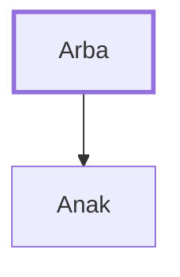

# Arba

Father of Anak, former name of Hebron

**Original-language names:** אַרְבַּע (H0704)

## When

- **Placed around:** [[connections/timeline/15th century BC|1443 BC]] *(Ussher: the median date of the passages naming them)*

## Family

- **Children:** [[connections/people/Anak|Anak]]
- **Tribe or nation:** Canaan

**Family group:** [[connections/genealogy/Family of Arba|Family of Arba]], generation 1

## Appears in

[[connections/chapters/06-joshua/Joshua 14|Joshua 14]] · [[connections/chapters/06-joshua/Joshua 15|Joshua 15]] · [[connections/chapters/06-joshua/Joshua 21|Joshua 21]]

## Appears in the same verse as

[[connections/places/Hebron|Hebron (3)]] · [[connections/people/Anak|Anak (2)]] · [[connections/people/Judah (Genesis 29.35)|Judah (Genesis 29.35) (2)]] · [[connections/people/Caleb (Numbers 13.6)|Caleb (Numbers 13.6)]] · [[connections/people/Jephunneh (Numbers 13.6)|Jephunneh (Numbers 13.6)]] · [[connections/people/Joshua (Exodus 17.9)|Joshua (Exodus 17.9)]]
