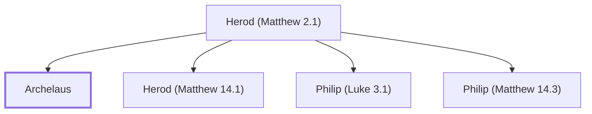

# Archelaus

Son of Herod the Great, Ethnarch of Judea

**Original-language names:** Ἀρχέλαος (G0745)

## When

- **Placed around:** [[connections/timeline/1st century BC|4 BC]] *(Ussher: the median date of the passages naming them)*
- **Reigned / in office:** [[connections/timeline/1st century BC|4 BC]] – [[connections/timeline/1st century AD|AD 6]] *(modern dates)* · Herod Archelaus, Herodian · [Wikidata Q244345](https://www.wikidata.org/wiki/Q244345)

## Family

- **Father:** [[connections/people/Herod (Matthew 2.1)|Herod (Matthew 2.1)]]
- **Brothers and sisters:** [[connections/people/Herod (Matthew 14.1)|Herod (Matthew 14.1)]], [[connections/people/Philip (Luke 3.1)|Philip (Luke 3.1)]], [[connections/people/Philip (Matthew 14.3)|Philip (Matthew 14.3)]]

**Family group:** [[connections/genealogy/Family of Herod (Matthew 2.1)|Family of Herod (Matthew 2.1)]], generation 2

## Appears in

[[connections/chapters/40-matthew/Matthew 2|Matthew 2]]

## Appears in the same verse as

[[connections/people/Herod (Matthew 2.1)|Herod (Matthew 2.1)]] · [[connections/places/Galilee|Galilee]] · [[connections/places/Judea|Judea]]
