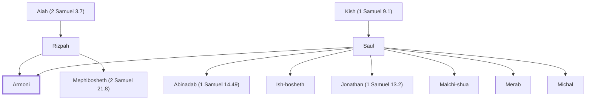

# Armoni

Son of Saul by Rizpah, killed by Gibeonites

**Original-language names:** אַרְמֹנִי (H0764)

## When

- **Placed around:** [[connections/timeline/11th century BC|1018 BC]] *(Ussher: the median date of the passages naming them)*

## Family

- **Father:** [[connections/people/Saul|Saul]]
- **Mother:** [[connections/people/Rizpah|Rizpah]]
- **Brothers and sisters:** [[connections/people/Abinadab (1 Samuel 14.49)|Abinadab (1 Samuel 14.49)]], [[connections/people/Ish-bosheth|Ish-bosheth]], [[connections/people/Jonathan (1 Samuel 13.2)|Jonathan (1 Samuel 13.2)]], [[connections/people/Malchi-shua|Malchi-shua]], [[connections/people/Mephibosheth (2 Samuel 21.8)|Mephibosheth (2 Samuel 21.8)]], [[connections/people/Merab|Merab]], [[connections/people/Michal|Michal]]
- **Tribe or nation:** Tribe of Benjamin

**Line of descent** (7 generations, father to son): [[connections/people/Aphiah|Aphiah]] → [[connections/people/Becorath|Becorath]] → [[connections/people/Zeror|Zeror]] → [[connections/people/Abiel|Abiel]] → [[connections/people/Kish (1 Samuel 9.1)|Kish (1 Samuel 9.1)]] → [[connections/people/Saul|Saul]] → **Armoni**

**Family group:** [[connections/genealogy/Family of Aphiah|Family of Aphiah]], generation 7

## Appears in

[[connections/chapters/10-2-samuel/2 Samuel 21|2 Samuel 21]]

## Appears in the same verse as

[[connections/people/Adriel|Adriel]] · [[connections/people/Aiah (2 Samuel 3.7)|Aiah (2 Samuel 3.7)]] · [[connections/people/Barzillai (2 Samuel 21.8)|Barzillai (2 Samuel 21.8)]] · [[connections/people/Mephibosheth (2 Samuel 21.8)|Mephibosheth (2 Samuel 21.8)]] · [[connections/people/Merab|Merab]] · [[connections/people/Rizpah|Rizpah]] · [[connections/people/Saul|Saul]]
