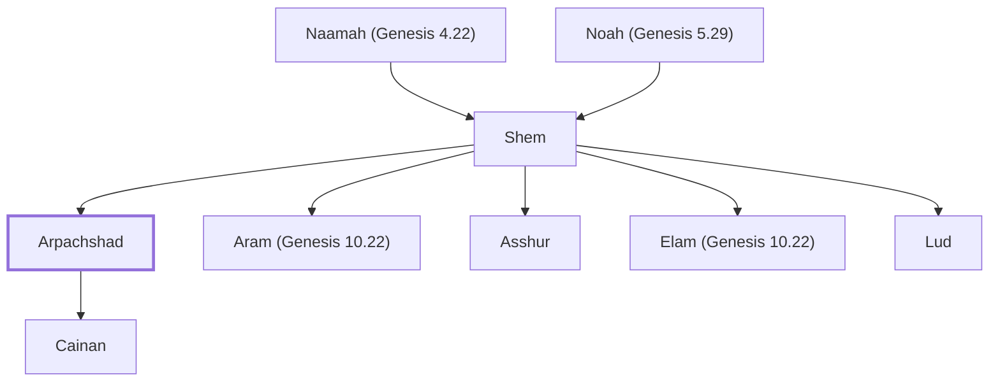

# Arpachshad

Son of Shem, ancestor of Abraham

**Also called:** Arphaxad

**Original-language names:** אַרְפַּכְשַׁד (H0775) · Ἀρφαξάδ (G0742)

## When

- **Lived:** [[connections/timeline/24th century BC|2346 BC]] – [[connections/timeline/20th century BC|1908 BC]] *(Jones)*
- **Placed around:** [[connections/timeline/24th century BC|2304 BC]] *(Ussher: the median date of the passages naming them)*

## Family

- **Father:** [[connections/people/Shem|Shem]]
- **Brothers and sisters:** [[connections/people/Aram (Genesis 10.22)|Aram (Genesis 10.22)]], [[connections/people/Asshur|Asshur]], [[connections/people/Elam (Genesis 10.22)|Elam (Genesis 10.22)]], [[connections/people/Lud|Lud]]
- **Children:** [[connections/people/Cainan|Cainan]]
- **Tribe or nation:** Early Patriarch

**Line of descent** (12 generations, father to son): [[connections/people/Adam|Adam]] → [[connections/people/Seth|Seth]] → [[connections/people/Enosh|Enosh]] → [[connections/people/Kenan|Kenan]] → [[connections/people/Mahalalel (Genesis 5.12)|Mahalalel (Genesis 5.12)]] → [[connections/people/Jared|Jared]] → [[connections/people/Enoch (Genesis 5.18)|Enoch (Genesis 5.18)]] → [[connections/people/Methuselah|Methuselah]] → [[connections/people/Lamech (Genesis 5.25)|Lamech (Genesis 5.25)]] → [[connections/people/Noah (Genesis 5.29)|Noah (Genesis 5.29)]] → [[connections/people/Shem|Shem]] → **Arpachshad**

**Family group:** [[connections/genealogy/Family of Adam|Family of Adam]], generation 12

## Events

- [[connections/timeline/24th century BC|2346 BC]] · [[connections/events/Birth of Arphaxad|Birth of Arphaxad]]
- [[connections/timeline/24th century BC|2346 BC]] · [[connections/events/Lifetime of Arphaxad|Lifetime of Arphaxad]]
- [[connections/timeline/24th century BC|2311 BC]] · [[connections/events/Birth of Salah|Birth of Salah]]
- [[connections/timeline/20th century BC|1908 BC]] · [[connections/events/Death of Arphaxad|Death of Arphaxad]]

## Appears in

[[connections/chapters/01-genesis/Genesis 10|Genesis 10 (2)]] · [[connections/chapters/01-genesis/Genesis 11|Genesis 11 (4)]] · [[connections/chapters/13-1-chronicles/1 Chronicles 1|1 Chronicles 1 (3)]] · [[connections/chapters/42-luke/Luke 3|Luke 3]]

## Appears in the same verse as

[[connections/people/Shem|Shem (6)]] · [[connections/people/Shelah (Genesis 10.24)|Shelah (Genesis 10.24) (5)]] · [[connections/people/Aram (Genesis 10.22)|Aram (Genesis 10.22) (2)]] · [[connections/people/Asshur|Asshur (2)]] · [[connections/people/Eber (Genesis 10.21)|Eber (Genesis 10.21) (2)]] · [[connections/people/Elam (Genesis 10.22)|Elam (Genesis 10.22) (2)]] · [[connections/people/Lud|Lud (2)]] · [[connections/people/Cainan|Cainan]] · [[connections/people/Gether|Gether]] · [[connections/people/Hul|Hul]] · [[connections/people/Lamech (Genesis 5.25)|Lamech (Genesis 5.25)]] · [[connections/people/Mash|Mash]] · [[connections/people/Noah (Genesis 5.29)|Noah (Genesis 5.29)]] · [[connections/people/Uz (Genesis 10.23)|Uz (Genesis 10.23)]]
