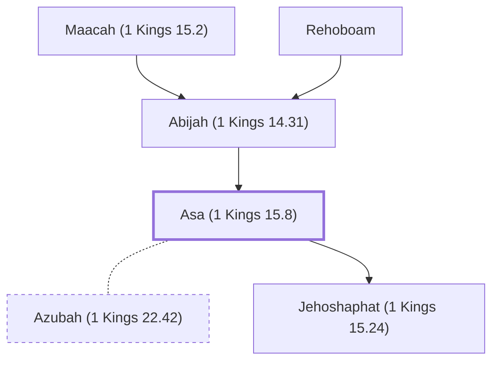

# Asa (1 Kings 15.8)

King of Judah, son of Abijah; father of Jehoshaphat

**Original-language names:** אָסָא (H0609) · Ἀσά (G0760)

## When

- **Lived:** ? – [[connections/timeline/10th century BC|914 BC]] *(Jones)*
- **Placed around:** [[connections/timeline/10th century BC|930 BC]] *(Ussher: the median date of the passages naming them)*

## Family

- **Father:** [[connections/people/Abijah (1 Kings 14.31)|Abijah (1 Kings 14.31)]]
- **Spouses:** [[connections/people/Azubah (1 Kings 22.42)|Azubah (1 Kings 22.42)]]
- **Children:** [[connections/people/Jehoshaphat (1 Kings 15.24)|Jehoshaphat (1 Kings 15.24)]]
- **Tribe or nation:** Tribe of Judah

**Line of descent** (38 generations, father to son): [[connections/people/Adam|Adam]] → [[connections/people/Seth|Seth]] → [[connections/people/Enosh|Enosh]] → [[connections/people/Kenan|Kenan]] → [[connections/people/Mahalalel (Genesis 5.12)|Mahalalel (Genesis 5.12)]] → [[connections/people/Jared|Jared]] → [[connections/people/Enoch (Genesis 5.18)|Enoch (Genesis 5.18)]] → [[connections/people/Methuselah|Methuselah]] → [[connections/people/Lamech (Genesis 5.25)|Lamech (Genesis 5.25)]] → [[connections/people/Noah (Genesis 5.29)|Noah (Genesis 5.29)]] → [[connections/people/Shem|Shem]] → [[connections/people/Arpachshad|Arpachshad]] → [[connections/people/Cainan|Cainan]] → [[connections/people/Shelah (Genesis 10.24)|Shelah (Genesis 10.24)]] → [[connections/people/Eber (Genesis 10.21)|Eber (Genesis 10.21)]] → [[connections/people/Peleg|Peleg]] → [[connections/people/Reu|Reu]] → [[connections/people/Serug|Serug]] → [[connections/people/Nahor (Genesis 11.22)|Nahor (Genesis 11.22)]] → [[connections/people/Terah|Terah]] → [[connections/people/Abraham|Abraham]] → [[connections/people/Isaac|Isaac]] → [[connections/people/Israel|Israel]] → [[connections/people/Judah (Genesis 29.35)|Judah (Genesis 29.35)]] → [[connections/people/Perez|Perez]] → [[connections/people/Hezron (Genesis 46.12)|Hezron (Genesis 46.12)]] → [[connections/people/Ram (Ruth 4.19)|Ram (Ruth 4.19)]] → [[connections/people/Amminadab (Exodus 6.23)|Amminadab (Exodus 6.23)]] → [[connections/people/Nahshon|Nahshon]] → [[connections/people/Salmon|Salmon]] → [[connections/people/Boaz|Boaz]] → [[connections/people/Obed (Ruth 4.17)|Obed (Ruth 4.17)]] → [[connections/people/Jesse|Jesse]] → [[connections/people/David|David]] → [[connections/people/Solomon|Solomon]] → [[connections/people/Rehoboam|Rehoboam]] → [[connections/people/Abijah (1 Kings 14.31)|Abijah (1 Kings 14.31)]] → **Asa (1 Kings 15.8)**

**Family group:** [[connections/genealogy/Family of Adam|Family of Adam]], generation 38

## Events

- [[connections/timeline/10th century BC|956 BC]] · [[connections/events/Reign of Asa|Reign of Asa]]
- [[connections/timeline/10th century BC|914 BC]] · [[connections/events/Death of Asa|Death of Asa]]

## Appears in

[[connections/chapters/11-1-kings/1 Kings 15|1 Kings 15 (16)]] · [[connections/chapters/11-1-kings/1 Kings 16|1 Kings 16 (5)]] · [[connections/chapters/11-1-kings/1 Kings 22|1 Kings 22 (3)]] · [[connections/chapters/13-1-chronicles/1 Chronicles 3|1 Chronicles 3]] · [[connections/chapters/14-2-chronicles/2 Chronicles 13|2 Chronicles 13]] · [[connections/chapters/14-2-chronicles/2 Chronicles 14|2 Chronicles 14 (6)]] · [[connections/chapters/14-2-chronicles/2 Chronicles 15|2 Chronicles 15 (6)]] · [[connections/chapters/14-2-chronicles/2 Chronicles 16|2 Chronicles 16 (9)]] · [[connections/chapters/14-2-chronicles/2 Chronicles 17|2 Chronicles 17]] · [[connections/chapters/14-2-chronicles/2 Chronicles 20|2 Chronicles 20]] · [[connections/chapters/14-2-chronicles/2 Chronicles 21|2 Chronicles 21]] · [[connections/chapters/24-jeremiah/Jeremiah 41|Jeremiah 41]] · [[connections/chapters/40-matthew/Matthew 1|Matthew 1 (2)]]

## Appears in the same verse as

[[connections/people/Judah (Genesis 29.35)|Judah (Genesis 29.35) (23)]] · [[connections/people/Israel|Israel (16)]] · [[connections/people/Baasha|Baasha (10)]] · [[connections/people/David|David (5)]] · [[connections/people/Jehoshaphat (1 Kings 15.24)|Jehoshaphat (1 Kings 15.24) (5)]] · [[connections/people/Abijah (1 Kings 14.31)|Abijah (1 Kings 14.31) (4)]] · [[connections/people/Ben-hadad (1 Kings 15.18)|Ben-hadad (1 Kings 15.18) (4)]] · [[connections/people/Benjamin (Genesis 35.18)|Benjamin (Genesis 35.18) (4)]] · [[connections/places/Ramah (Joshua 18.25)|Ramah (Joshua 18.25) (4)]] · [[connections/places/Tirzah|Tirzah (4)]] · [[connections/places/Syria|Syria (3)]] · [[connections/people/Ahab (1 Kings 16.28)|Ahab (1 Kings 16.28) (2)]] · [[connections/people/Ephraim|Ephraim (2)]] · [[connections/people/Jeroboam (1 Kings 11.26)|Jeroboam (1 Kings 11.26) (2)]] · [[connections/people/Maacah (1 Kings 15.2)|Maacah (1 Kings 15.2) (2)]] · [[connections/people/Naphtali|Naphtali (2)]] · [[connections/people/Omri (1 Kings 16.16)|Omri (1 Kings 16.16) (2)]] · [[connections/people/Rehoboam|Rehoboam (2)]] · [[connections/people/Solomon|Solomon (2)]] · [[connections/people/Zimri (1 Kings 16.9)|Zimri (1 Kings 16.9) (2)]] · [[connections/places/Abel-beth-maacah|Abel-beth-maacah (2)]] · [[connections/places/Damascus|Damascus (2)]] · [[connections/places/Dan|Dan (2)]] · [[connections/places/Geba|Geba (2)]] · [[connections/places/Ijon|Ijon (2)]] · [[connections/places/Kidron|Kidron (2)]] · [[connections/places/Mizpah|Mizpah (2)]] · [[connections/people/Ahijah (1 Kings 15.27)|Ahijah (1 Kings 15.27)]] · [[connections/people/Elah (1 Kings 16.6)|Elah (1 Kings 16.6)]] · [[connections/people/Elijah (1 Kings 17.1)|Elijah (1 Kings 17.1)]] · [[connections/people/Gedaliah (2 Kings 25.22)|Gedaliah (2 Kings 25.22)]] · [[connections/people/Hanani (1 Kings 16.1)|Hanani (1 Kings 16.1)]] · [[connections/people/Hezion|Hezion]] · [[connections/people/Ishmael (2 Kings 25.23)|Ishmael (2 Kings 25.23)]] · [[connections/people/Jehoram (1 Kings 22.51)|Jehoram (1 Kings 22.51)]] · [[connections/people/Nadab (1 Kings 14.20)|Nadab (1 Kings 14.20)]] · [[connections/people/Nethaniah (2 Kings 25.23)|Nethaniah (2 Kings 25.23)]] · [[connections/people/Oded (2 Chronicles 15.1)|Oded (2 Chronicles 15.1)]] · [[connections/people/Tabrimmon|Tabrimmon]] · [[connections/people/Uzziah (2 Kings 14.21)|Uzziah (2 Kings 14.21)]] · [[connections/places/Chinnereth|Chinnereth]] · [[connections/places/Gerar|Gerar]] · [[connections/places/Gibbethon|Gibbethon]] · [[connections/places/Jerusalem|Jerusalem]] · [[connections/places/Mareshah|Mareshah]] · [[connections/places/Samaria|Samaria]] · [[connections/places/Zephathah Valley|Zephathah Valley]]
