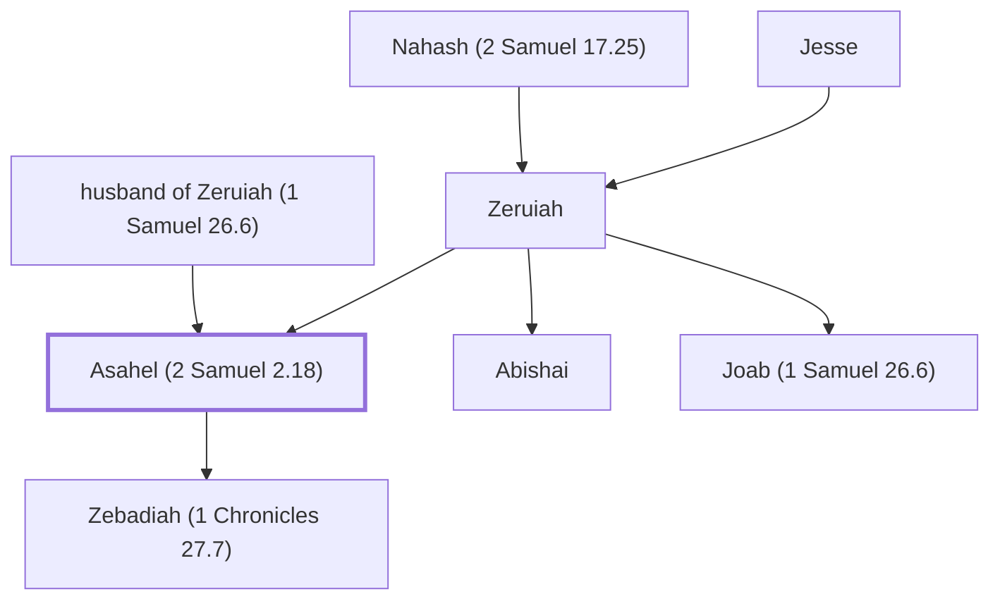

# Asahel (2 Samuel 2.18)

Son of Zeruiah, brother of Joab, killed by Abner

**Original-language names:** עֲשָׂהאֵל (H6214)

## When

- **Placed around:** [[connections/timeline/11th century BC|1053 BC]] *(Ussher: the median date of the passages naming them)*

## Family

- **Father:** [[connections/people/husband of Zeruiah (1 Samuel 26.6)|husband of Zeruiah (1 Samuel 26.6)]]
- **Mother:** [[connections/people/Zeruiah|Zeruiah]]
- **Brothers and sisters:** [[connections/people/Abishai|Abishai]], [[connections/people/Joab (1 Samuel 26.6)|Joab (1 Samuel 26.6)]]
- **Children:** [[connections/people/Zebadiah (1 Chronicles 27.7)|Zebadiah (1 Chronicles 27.7)]]
- **Tribe or nation:** Tribe of Judah

**Family group:** [[connections/genealogy/Family of Adam|Family of Adam]], generation 37

## Appears in

[[connections/chapters/10-2-samuel/2 Samuel 2|2 Samuel 2 (8)]] · [[connections/chapters/10-2-samuel/2 Samuel 3|2 Samuel 3 (2)]] · [[connections/chapters/10-2-samuel/2 Samuel 23|2 Samuel 23]] · [[connections/chapters/13-1-chronicles/1 Chronicles 2|1 Chronicles 2]] · [[connections/chapters/13-1-chronicles/1 Chronicles 11|1 Chronicles 11]] · [[connections/chapters/13-1-chronicles/1 Chronicles 27|1 Chronicles 27]]

## Appears in the same verse as

[[connections/people/Joab (1 Samuel 26.6)|Joab (1 Samuel 26.6) (10)]] · [[connections/people/Abner|Abner (8)]] · [[connections/people/Abishai|Abishai (3)]] · [[connections/places/Bethlehem (Genesis 35.16)|Bethlehem (Genesis 35.16) (3)]] · [[connections/people/Dodo (2 Samuel 23.24)|Dodo (2 Samuel 23.24) (2)]] · [[connections/people/Elhanan (2 Samuel 23.24)|Elhanan (2 Samuel 23.24) (2)]] · [[connections/people/Zeruiah|Zeruiah (2)]] · [[connections/places/Hebron|Hebron (2)]] · [[connections/people/Abigail (2 Samuel 17.25)|Abigail (2 Samuel 17.25)]] · [[connections/people/David|David]] · [[connections/people/Zebadiah (1 Chronicles 27.7)|Zebadiah (1 Chronicles 27.7)]] · [[connections/places/Gibeon|Gibeon]]
