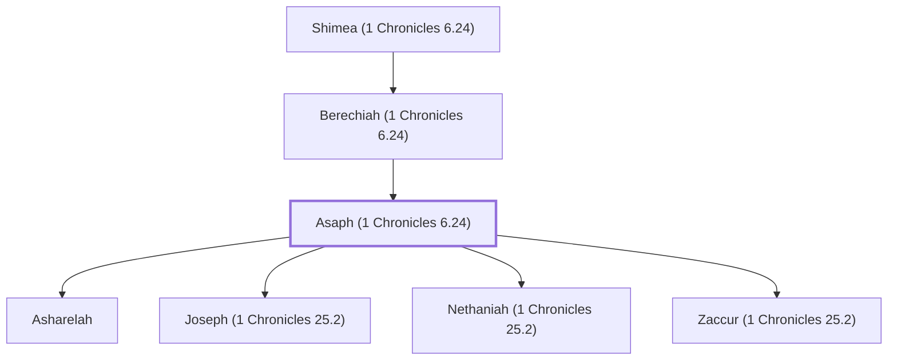

# Asaph (1 Chronicles 6.24)

Levite musician, psalmist, and ancestor of temple singers

**Original-language names:** אָסָף (H0623)

## When

- **Placed around:** [[connections/timeline/11th century BC|1015 BC]] *(Ussher: the median date of the passages naming them)*

## Family

- **Father:** [[connections/people/Berechiah (1 Chronicles 6.24)|Berechiah (1 Chronicles 6.24)]]
- **Children:** [[connections/people/Asharelah|Asharelah]], [[connections/people/Joseph (1 Chronicles 25.2)|Joseph (1 Chronicles 25.2)]], [[connections/people/Nethaniah (1 Chronicles 25.2)|Nethaniah (1 Chronicles 25.2)]], [[connections/people/Zaccur (1 Chronicles 25.2)|Zaccur (1 Chronicles 25.2)]]
- **Tribe or nation:** Tribe of Levi

**Line of descent** (39 generations, father to son): [[connections/people/Adam|Adam]] → [[connections/people/Seth|Seth]] → [[connections/people/Enosh|Enosh]] → [[connections/people/Kenan|Kenan]] → [[connections/people/Mahalalel (Genesis 5.12)|Mahalalel (Genesis 5.12)]] → [[connections/people/Jared|Jared]] → [[connections/people/Enoch (Genesis 5.18)|Enoch (Genesis 5.18)]] → [[connections/people/Methuselah|Methuselah]] → [[connections/people/Lamech (Genesis 5.25)|Lamech (Genesis 5.25)]] → [[connections/people/Noah (Genesis 5.29)|Noah (Genesis 5.29)]] → [[connections/people/Shem|Shem]] → [[connections/people/Arpachshad|Arpachshad]] → [[connections/people/Cainan|Cainan]] → [[connections/people/Shelah (Genesis 10.24)|Shelah (Genesis 10.24)]] → [[connections/people/Eber (Genesis 10.21)|Eber (Genesis 10.21)]] → [[connections/people/Peleg|Peleg]] → [[connections/people/Reu|Reu]] → [[connections/people/Serug|Serug]] → [[connections/people/Nahor (Genesis 11.22)|Nahor (Genesis 11.22)]] → [[connections/people/Terah|Terah]] → [[connections/people/Abraham|Abraham]] → [[connections/people/Isaac|Isaac]] → [[connections/people/Israel|Israel]] → [[connections/people/Levi (Genesis 29.34)|Levi (Genesis 29.34)]] → [[connections/people/Gershon|Gershon]] → [[connections/people/Libni (Exodus 6.17)|Libni (Exodus 6.17)]] → [[connections/people/Jehiel (1 Chronicles 6.5)|Jehiel (1 Chronicles 6.5)]] → [[connections/people/Shimei (1 Chronicles 6.27)|Shimei (1 Chronicles 6.27)]] → [[connections/people/Zimmah (1 Chronicles 6.5)|Zimmah (1 Chronicles 6.5)]] → [[connections/people/Joah (1 Chronicles 6.6)|Joah (1 Chronicles 6.6)]] → [[connections/people/Iddo (1 Chronicles 6.6)|Iddo (1 Chronicles 6.6)]] → [[connections/people/Zerah (1 Chronicles 6.6)|Zerah (1 Chronicles 6.6)]] → [[connections/people/Jeatherai|Jeatherai]] → [[connections/people/Malchijah (1 Chronicles 6.25)|Malchijah (1 Chronicles 6.25)]] → [[connections/people/Baaseiah|Baaseiah]] → [[connections/people/Michael (1 Chronicles 6.25)|Michael (1 Chronicles 6.25)]] → [[connections/people/Shimea (1 Chronicles 6.24)|Shimea (1 Chronicles 6.24)]] → [[connections/people/Berechiah (1 Chronicles 6.24)|Berechiah (1 Chronicles 6.24)]] → **Asaph (1 Chronicles 6.24)**

**Family group:** [[connections/genealogy/Family of Adam|Family of Adam]], generation 39

## Appears in

[[connections/chapters/13-1-chronicles/1 Chronicles 6|1 Chronicles 6]] · [[connections/chapters/13-1-chronicles/1 Chronicles 15|1 Chronicles 15 (2)]] · [[connections/chapters/13-1-chronicles/1 Chronicles 16|1 Chronicles 16 (3)]] · [[connections/chapters/13-1-chronicles/1 Chronicles 25|1 Chronicles 25 (4)]] · [[connections/chapters/14-2-chronicles/2 Chronicles 5|2 Chronicles 5]] · [[connections/chapters/14-2-chronicles/2 Chronicles 20|2 Chronicles 20]] · [[connections/chapters/14-2-chronicles/2 Chronicles 29|2 Chronicles 29 (2)]] · [[connections/chapters/14-2-chronicles/2 Chronicles 35|2 Chronicles 35]] · [[connections/chapters/15-ezra/Ezra 2|Ezra 2]] · [[connections/chapters/15-ezra/Ezra 3|Ezra 3]] · [[connections/chapters/16-nehemiah/Nehemiah 7|Nehemiah 7]] · [[connections/chapters/16-nehemiah/Nehemiah 11|Nehemiah 11]] · [[connections/chapters/16-nehemiah/Nehemiah 12|Nehemiah 12 (2)]] · [[connections/chapters/19-psalms/Psalms 50|Psalms 50]] · [[connections/chapters/19-psalms/Psalms 73|Psalms 73]] · [[connections/chapters/19-psalms/Psalms 74|Psalms 74]] · [[connections/chapters/19-psalms/Psalms 75|Psalms 75]] · [[connections/chapters/19-psalms/Psalms 76|Psalms 76]] · [[connections/chapters/19-psalms/Psalms 77|Psalms 77]] · [[connections/chapters/19-psalms/Psalms 78|Psalms 78]] · [[connections/chapters/19-psalms/Psalms 79|Psalms 79]] · [[connections/chapters/19-psalms/Psalms 80|Psalms 80]] · [[connections/chapters/19-psalms/Psalms 81|Psalms 81]] · [[connections/chapters/19-psalms/Psalms 82|Psalms 82]] · [[connections/chapters/19-psalms/Psalms 83|Psalms 83]]

## Appears in the same verse as

[[connections/people/Jeduthun (1 Chronicles 6.29)|Jeduthun (1 Chronicles 6.29) (7)]] · [[connections/people/David|David (6)]] · [[connections/people/Heman (1 Chronicles 6.18)|Heman (1 Chronicles 6.18) (6)]] · [[connections/people/Berechiah (1 Chronicles 6.24)|Berechiah (1 Chronicles 6.24) (2)]] · [[connections/people/Joseph (1 Chronicles 25.2)|Joseph (1 Chronicles 25.2) (2)]] · [[connections/people/Mattaniah (Nehemiah 11.22)|Mattaniah (Nehemiah 11.22) (2)]] · [[connections/people/Mica (Nehemiah 11.22)|Mica (Nehemiah 11.22) (2)]] · [[connections/people/Zaccur (1 Chronicles 25.2)|Zaccur (1 Chronicles 25.2) (2)]] · [[connections/people/Asharelah|Asharelah]] · [[connections/people/Bani (Nehemiah 11.22)|Bani (Nehemiah 11.22)]] · [[connections/people/Benaiah (1 Chronicles 15.18)|Benaiah (1 Chronicles 15.18)]] · [[connections/people/Benaiah (2 Chronicles 20.14)|Benaiah (2 Chronicles 20.14)]] · [[connections/people/Eliab (1 Chronicles 15.18)|Eliab (1 Chronicles 15.18)]] · [[connections/people/Elizaphan (Exodus 6.22)|Elizaphan (Exodus 6.22)]] · [[connections/people/Gedaliah (1 Chronicles 25.3)|Gedaliah (1 Chronicles 25.3)]] · [[connections/people/Hashabiah (Nehemiah 11.22)|Hashabiah (Nehemiah 11.22)]] · [[connections/people/Hezekiah (2 Kings 16.20)|Hezekiah (2 Kings 16.20)]] · [[connections/people/Israel|Israel]] · [[connections/people/Jaaziel|Jaaziel]] · [[connections/people/Jahaziel (2 Chronicles 20.14)|Jahaziel (2 Chronicles 20.14)]] · [[connections/people/Jehiel (1 Chronicles 15.18)|Jehiel (1 Chronicles 15.18)]] · [[connections/people/Jeiel (1 Chronicles 15.18)|Jeiel (1 Chronicles 15.18)]] · [[connections/people/Jeiel (2 Chronicles 20.14)|Jeiel (2 Chronicles 20.14)]] · [[connections/people/Jeuel (2 Chronicles 29.13)|Jeuel (2 Chronicles 29.13)]] · [[connections/people/Joel (1 Samuel 8.2)|Joel (1 Samuel 8.2)]] · [[connections/people/Jonathan (Nehemiah 12.35)|Jonathan (Nehemiah 12.35)]] · [[connections/people/Kishi|Kishi]] · [[connections/people/Mattaniah (2 Chronicles 20.14)|Mattaniah (2 Chronicles 20.14)]] · [[connections/people/Mattaniah (2 Chronicles 29.13)|Mattaniah (2 Chronicles 29.13)]] · [[connections/people/Mattithiah (1 Chronicles 15.18)|Mattithiah (1 Chronicles 15.18)]] · [[connections/people/Merari|Merari]] · [[connections/people/Nethaniah (1 Chronicles 25.2)|Nethaniah (1 Chronicles 25.2)]] · [[connections/people/Obed-edom|Obed-edom]] · [[connections/people/Shemaiah (Nehemiah 12.35)|Shemaiah (Nehemiah 12.35)]] · [[connections/people/Shemiramoth (1 Chronicles 15.18)|Shemiramoth (1 Chronicles 15.18)]] · [[connections/people/Shimea (1 Chronicles 6.24)|Shimea (1 Chronicles 6.24)]] · [[connections/people/Shimri (2 Chronicles 29.13)|Shimri (2 Chronicles 29.13)]] · [[connections/people/Uzzi (Nehemiah 11.22)|Uzzi (Nehemiah 11.22)]] · [[connections/people/Zechariah (1 Chronicles 9.21)|Zechariah (1 Chronicles 9.21)]] · [[connections/people/Zechariah (2 Chronicles 20.14)|Zechariah (2 Chronicles 20.14)]] · [[connections/people/Zechariah (2 Chronicles 29.13)|Zechariah (2 Chronicles 29.13)]] · [[connections/people/Zechariah (Nehemiah 12.35)|Zechariah (Nehemiah 12.35)]] · [[connections/places/Jerusalem|Jerusalem]]
