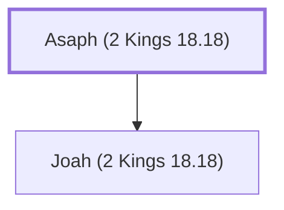

# Asaph (2 Kings 18.18)

Recorder during King Hezekiah's reign

**Original-language names:** אָסָף (H0623)

## When

- **Placed around:** [[connections/timeline/8th century BC|710 BC]] *(Ussher: the median date of the passages naming them)*

## Family

- **Children:** [[connections/people/Joah (2 Kings 18.18)|Joah (2 Kings 18.18)]]

**Family group:** [[connections/genealogy/Family of Asaph (2 Kings 18.18)|Family of Asaph (2 Kings 18.18)]], generation 1

## Appears in

[[connections/chapters/12-2-kings/2 Kings 18|2 Kings 18 (2)]] · [[connections/chapters/23-isaiah/Isaiah 36|Isaiah 36 (2)]]

## Appears in the same verse as

[[connections/people/Eliakim (2 Kings 18.18)|Eliakim (2 Kings 18.18) (4)]] · [[connections/people/Hilkiah (2 Kings 18.18)|Hilkiah (2 Kings 18.18) (4)]] · [[connections/people/Joah (2 Kings 18.18)|Joah (2 Kings 18.18) (4)]] · [[connections/people/Shebna|Shebna (4)]] · [[connections/people/Hezekiah (2 Kings 16.20)|Hezekiah (2 Kings 16.20) (2)]] · [[connections/people/Rabshakeh|Rabshakeh (2)]]
