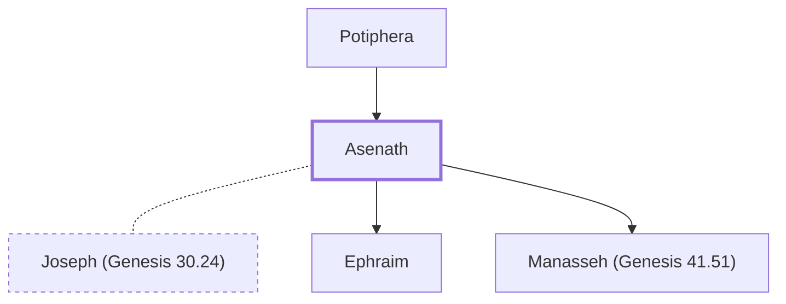

# Asenath

Egyptian wife of Joseph; mother of Manasseh and Ephraim

**Original-language names:** אָֽסְנַת (H0621)

## When

- **Placed around:** [[connections/timeline/18th century BC|1715 BC]] *(Ussher: the median date of the passages naming them)*

## Family

- **Father:** [[connections/people/Potiphera|Potiphera]]
- **Spouses:** [[connections/people/Joseph (Genesis 30.24)|Joseph (Genesis 30.24)]]
- **Children:** [[connections/people/Ephraim|Ephraim]], [[connections/people/Manasseh (Genesis 41.51)|Manasseh (Genesis 41.51)]]

**Family group:** [[connections/genealogy/Family of Adam|Family of Adam]], generation 2

## Appears in

[[connections/chapters/01-genesis/Genesis 41|Genesis 41 (2)]] · [[connections/chapters/01-genesis/Genesis 46|Genesis 46]]

## Appears in the same verse as

[[connections/people/Joseph (Genesis 30.24)|Joseph (Genesis 30.24) (3)]] · [[connections/people/Potiphera|Potiphera (3)]] · [[connections/places/On|On (3)]] · [[connections/places/Egypt|Egypt (2)]] · [[connections/people/Ephraim|Ephraim]] · [[connections/people/Manasseh (Genesis 41.51)|Manasseh (Genesis 41.51)]] · [[connections/people/Pharaoh (Genesis 37.36)|Pharaoh (Genesis 37.36)]]
