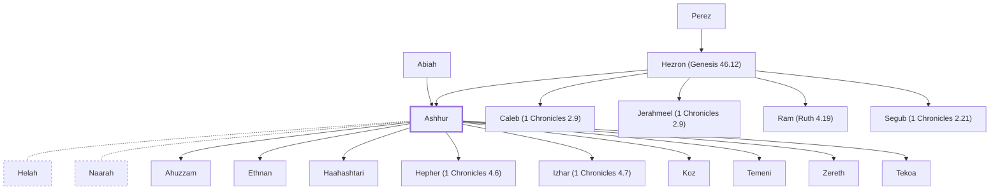

# Ashhur

Descendant of Judah through Hezron

**Original-language names:** אַשְׁחוּר (H0806)

## When

- **Placed around:** [[connections/timeline/15th century BC|1470 BC]] *(Ussher: the median date of the passages naming them)*

## Family

- **Father:** [[connections/people/Hezron (Genesis 46.12)|Hezron (Genesis 46.12)]]
- **Mother:** [[connections/people/Abiah|Abiah]]
- **Brothers and sisters:** [[connections/people/Caleb (1 Chronicles 2.9)|Caleb (1 Chronicles 2.9)]], [[connections/people/Jerahmeel (1 Chronicles 2.9)|Jerahmeel (1 Chronicles 2.9)]], [[connections/people/Ram (Ruth 4.19)|Ram (Ruth 4.19)]], [[connections/people/Segub (1 Chronicles 2.21)|Segub (1 Chronicles 2.21)]]
- **Spouses:** [[connections/people/Helah|Helah]], [[connections/people/Naarah|Naarah]]
- **Children:** [[connections/people/Ahuzzam|Ahuzzam]], [[connections/people/Ethnan|Ethnan]], [[connections/people/Haahashtari|Haahashtari]], [[connections/people/Hepher (1 Chronicles 4.6)|Hepher (1 Chronicles 4.6)]], [[connections/people/Izhar (1 Chronicles 4.7)|Izhar (1 Chronicles 4.7)]], [[connections/people/Koz|Koz]], [[connections/people/Temeni|Temeni]], [[connections/people/Zereth|Zereth]], [[connections/places/Tekoa|Tekoa (founder)]]
- **Tribe or nation:** Tribe of Judah

**Line of descent** (27 generations, father to son): [[connections/people/Adam|Adam]] → [[connections/people/Seth|Seth]] → [[connections/people/Enosh|Enosh]] → [[connections/people/Kenan|Kenan]] → [[connections/people/Mahalalel (Genesis 5.12)|Mahalalel (Genesis 5.12)]] → [[connections/people/Jared|Jared]] → [[connections/people/Enoch (Genesis 5.18)|Enoch (Genesis 5.18)]] → [[connections/people/Methuselah|Methuselah]] → [[connections/people/Lamech (Genesis 5.25)|Lamech (Genesis 5.25)]] → [[connections/people/Noah (Genesis 5.29)|Noah (Genesis 5.29)]] → [[connections/people/Shem|Shem]] → [[connections/people/Arpachshad|Arpachshad]] → [[connections/people/Cainan|Cainan]] → [[connections/people/Shelah (Genesis 10.24)|Shelah (Genesis 10.24)]] → [[connections/people/Eber (Genesis 10.21)|Eber (Genesis 10.21)]] → [[connections/people/Peleg|Peleg]] → [[connections/people/Reu|Reu]] → [[connections/people/Serug|Serug]] → [[connections/people/Nahor (Genesis 11.22)|Nahor (Genesis 11.22)]] → [[connections/people/Terah|Terah]] → [[connections/people/Abraham|Abraham]] → [[connections/people/Isaac|Isaac]] → [[connections/people/Israel|Israel]] → [[connections/people/Judah (Genesis 29.35)|Judah (Genesis 29.35)]] → [[connections/people/Perez|Perez]] → [[connections/people/Hezron (Genesis 46.12)|Hezron (Genesis 46.12)]] → **Ashhur**

**Family group:** [[connections/genealogy/Family of Adam|Family of Adam]], generation 27

## Appears in

[[connections/chapters/13-1-chronicles/1 Chronicles 2|1 Chronicles 2]] · [[connections/chapters/13-1-chronicles/1 Chronicles 4|1 Chronicles 4]]

## Appears in the same verse as

[[connections/places/Tekoa|Tekoa (2)]] · [[connections/people/Abiah|Abiah]] · [[connections/people/Caleb (1 Chronicles 2.9)|Caleb (1 Chronicles 2.9)]] · [[connections/people/Ephrathah|Ephrathah]] · [[connections/people/Helah|Helah]] · [[connections/people/Hezron (Genesis 46.12)|Hezron (Genesis 46.12)]] · [[connections/people/Naarah|Naarah]] · [[connections/places/Caleb Ephrathah|Caleb Ephrathah]]
