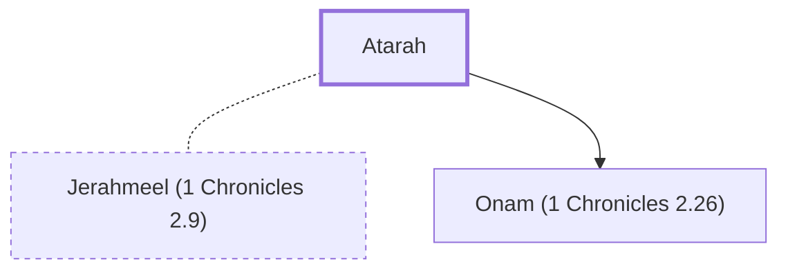

# Atarah

Wife of Jerahmeel; mother of Onam

**Original-language names:** עֲטָרָה (H5851)

## When

- **Placed around:** [[connections/timeline/15th century BC|1470 BC]] *(Ussher: the median date of the passages naming them)*

## Family

- **Spouses:** [[connections/people/Jerahmeel (1 Chronicles 2.9)|Jerahmeel (1 Chronicles 2.9)]]
- **Children:** [[connections/people/Onam (1 Chronicles 2.26)|Onam (1 Chronicles 2.26)]]
- **Tribe or nation:** Tribe of Judah(?)

**Family group:** [[connections/genealogy/Family of Adam|Family of Adam]], generation 29

## Appears in

[[connections/chapters/13-1-chronicles/1 Chronicles 2|1 Chronicles 2]]

## Appears in the same verse as

[[connections/people/Jerahmeel (1 Chronicles 2.9)|Jerahmeel (1 Chronicles 2.9)]] · [[connections/people/Onam (1 Chronicles 2.26)|Onam (1 Chronicles 2.26)]]
