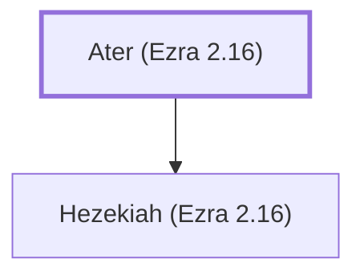

# Ater (Ezra 2.16)

Head of a family that returned from Babylonian exile

**Original-language names:** אָטֵר (H0333)

## When

- **Placed around:** [[connections/timeline/5th century BC|445 BC]] *(Ussher: the median date of the passages naming them)*

## Family

- **Children:** [[connections/people/Hezekiah (Ezra 2.16)|Hezekiah (Ezra 2.16)]]

**Family group:** [[connections/genealogy/Family of Ater (Ezra 2.16)|Family of Ater (Ezra 2.16)]], generation 1

## Appears in

[[connections/chapters/15-ezra/Ezra 2|Ezra 2]] · [[connections/chapters/16-nehemiah/Nehemiah 7|Nehemiah 7]]

## Appears in the same verse as

[[connections/people/Hezekiah (Ezra 2.16)|Hezekiah (Ezra 2.16) (2)]]
